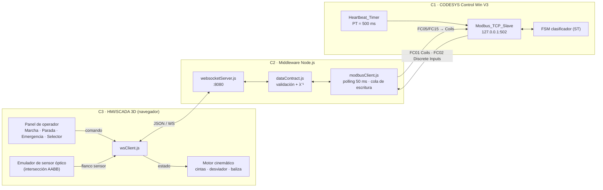
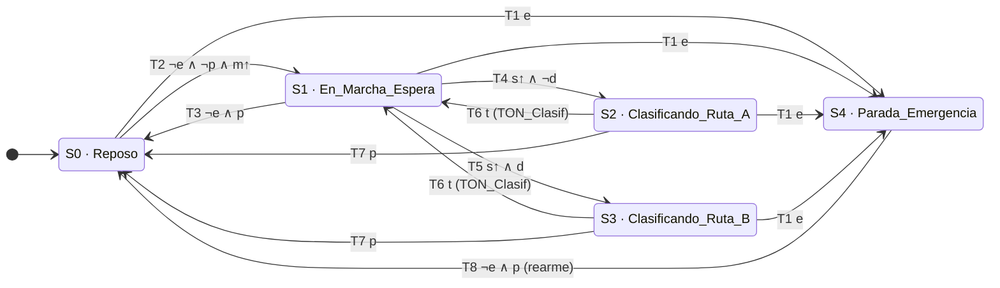
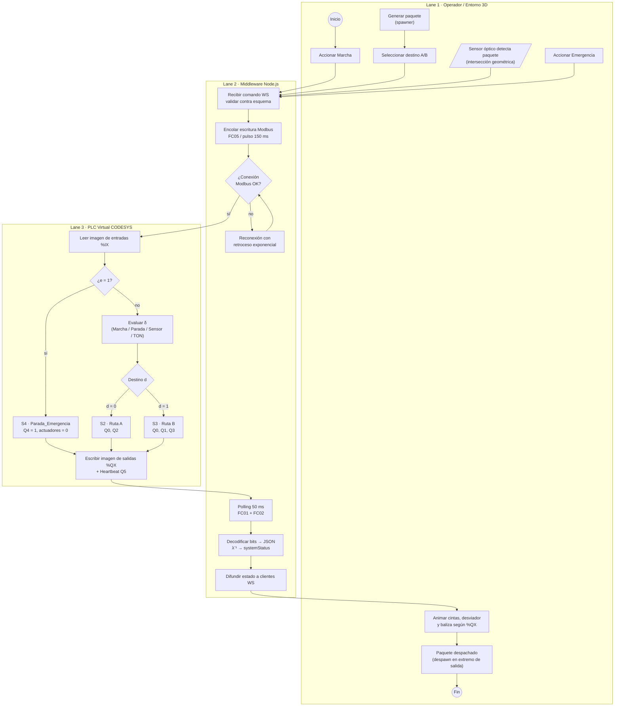
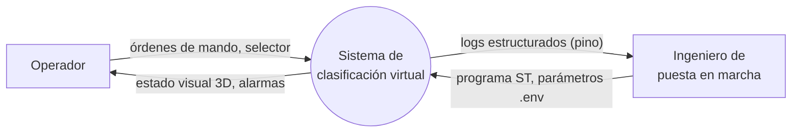
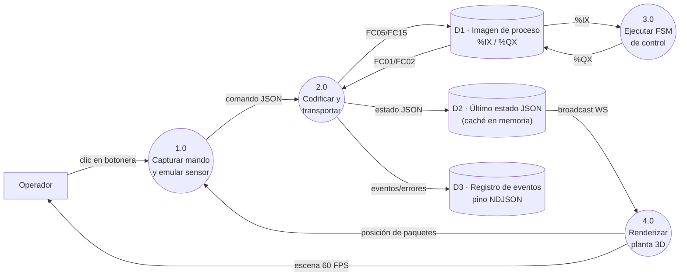
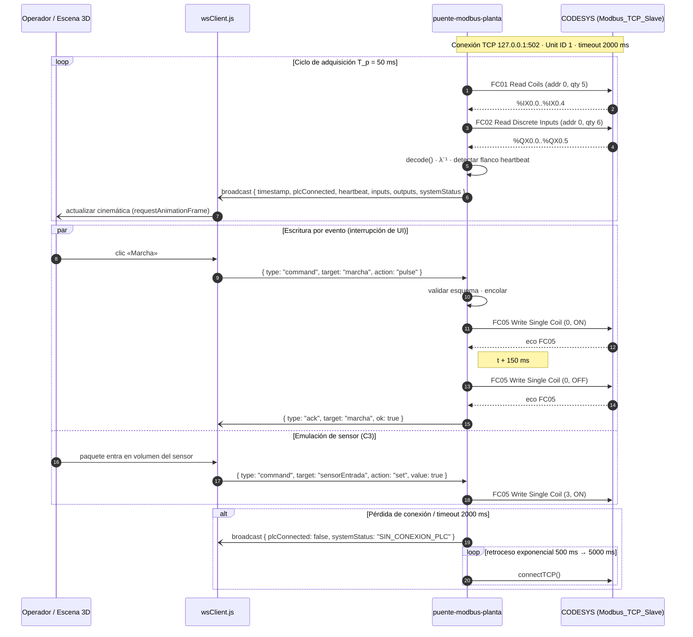

# 01 · Arquitectura, modelo de control y flujos de datos

**Proyecto:** Planta Virtual de Clasificación Gobernada por PLC (*Virtual Commissioning*)
**Fase:** 1 — Ingeniería de detalle · **Versión:** 0.1.0 · **Fecha:** 2026-10-22

---

## 1. Propósito y alcance

El presente documento formaliza la arquitectura del sistema, el modelo matemático del controlador de clasificación y los flujos de información entre sus tres capas. Se adopta el paradigma de puesta en marcha virtual (*virtual commissioning*), en el cual un controlador real —aquí, un PLC virtual conforme a IEC 61131-3 (International Electrotechnical Commission [IEC], 2013)— gobierna un modelo de planta simulado en lugar del equipo físico. La jerarquía funcional se alinea con los niveles 0–2 del modelo ISA-95 (International Society of Automation [ISA], 2010): el gemelo 3D emula el nivel 0–1 (proceso, sensores y actuadores), el PLC constituye el nivel 1–2 (control) y el middleware actúa como pasarela de integración hacia la supervisión (HMI/SCADA).

## 2. Arquitectura de tres capas

| Capa                 | Componente               | Responsabilidad                                                               | Tecnología                                           | Interfaz                                    |
| -------------------- | ------------------------ | ----------------------------------------------------------------------------- | ----------------------------------------------------- | ------------------------------------------- |
| C1 · Control (OT)   | PLC virtual              | Única fuente de decisión lógica: FSM, enclavamientos, heartbeat            | CODESYS V3.5 + Control Win V3 x64, ST                 | Esclavo Modbus TCP `127.0.0.1:502`        |
| C2 · Middleware     | `puente-modbus-planta` | Adquisición cíclica, escritura por evento, serialización JSON, reconexión | Node.js ≥ 20.19, `modbus-serial`, `ws`, `pino` | Cliente Modbus TCP ↔ servidor WS `:8080` |
| C3 · Visualización | `hmi-planta-3d`        | Emulación cinemática reactiva, emulación de sensores, mando del operador   | Vite, Three.js, Tailwind CSS                          | Cliente WebSocket (RFC 6455)                |

**Principio de desacoplamiento.** La capa C3 se modela como *planta + HMI*: (i) traduce estados de actuadores (`%QX`) en movimiento, y (ii) emula sensores a partir de la geometría (p. ej., el paquete intersecta el volumen del sensor óptico → `Sensor_Entrada = 1`). En ningún caso C3 decide transiciones de proceso. C2 es semánticamente transparente: no contiene lógica de control, solo codificación, transporte y diagnóstico de comunicaciones.

## 3. Modelo matemático del controlador

### 3.1 Definición formal

El clasificador se modela como una máquina de Moore (Moore, 1956), extensión transductora del autómata finito $M = (S, \Sigma, \delta, s_0, F)$ (Hopcroft et al., 2006):

$$
M = (S,\ \Sigma,\ \Lambda,\ \delta,\ \lambda,\ s_0,\ F)
$$

| Elemento    | Definición                                                                                                                                                                         |
| ----------- | ----------------------------------------------------------------------------------------------------------------------------------------------------------------------------------- |
| $S$       | $\{S_0{:}\ \text{Reposo},\ S_1{:}\ \text{En\_Marcha\_Espera},\ S_2{:}\ \text{Clasificando\_Ruta\_A},\ S_3{:}\ \text{Clasificando\_Ruta\_B},\ S_4{:}\ \text{Parada\_Emergencia}\}$ |
| $\Sigma$  | $\mathbb{B}^6$, vector de entrada por ciclo de *scan* $k$: $\sigma_k = (m^{\uparrow}, p, e, s^{\uparrow}, d, t)$                                                            |
| $\Lambda$ | $\mathbb{B}^5$, vector de salida $(Q_0,\dots,Q_4)$; $Q_5$ (heartbeat) es ortogonal a la FSM                                                                                   |
| $\delta$  | $S \times \Sigma \to S$, función de transición (§3.3)                                                                                                                          |
| $\lambda$ | $S \to \Lambda$, función de salida de Moore (§3.4)                                                                                                                              |
| $s_0$     | $S_0$ (Reposo), estado tras arranque en frío/caliente del runtime                                                                                                                |
| $F$       | $\{S_0\}$, conjunto de estados seguros de referencia: todo actuador desenergizado y sin alarma                                                                                    |

### 3.2 Variables de entrada y operadores

| Símbolo | Origen                      | Semántica                                                                                                     |
| -------- | --------------------------- | -------------------------------------------------------------------------------------------------------------- |
| $m$    | `%IX0.0` Marcha           | Pulsador momentáneo; se emplea su flanco $m^{\uparrow}$                                                     |
| $p$    | `%IX0.1` Parada           | Pulsador momentáneo; prioridad sobre Marcha                                                                   |
| $e$    | `%IX0.2` Emergencia       | Nivel enclavado; **$e = 1 \Leftrightarrow$ emergencia activa** (lógica positiva en el modelo virtual) |
| $s$    | `%IX0.3` Sensor_Entrada   | Nivel de presencia emulado por C3; se emplea $s^{\uparrow}$                                                  |
| $d$    | `%IX0.4` Selector_Destino | $0 \to$ Ruta A, $1 \to$ Ruta B; se muestrea en el instante de $s^{\uparrow}$                             |
| $t$    | interno                     | Salida de `TON_Clasif` con $IN = y_2 \lor y_3$, $PT = T_{clas}$                                          |

Detección de flanco ascendente (bloque estándar `R_TRIG`, IEC, 2013):

$$
x^{\uparrow}(k) = x(k) \land \lnot x(k-1)
$$

El tiempo de clasificación se dimensiona como tiempo de despeje del paquete desde el sensor hasta el extremo de la cinta de salida:

$$
T_{clas} \geq \frac{L_d + L_s}{v_c} + \varepsilon, \qquad \text{p. ej. } \frac{0.6 + 1.6\ \text{m}}{0.6\ \text{m/s}} + 0.33\ \text{s} \approx 4\ \text{s} \Rightarrow T_{clas} := \texttt{T\#4s}
$$

donde $L_d$ es la longitud de la zona de desvío, $L_s$ la de la cinta de salida, $v_c$ la velocidad lineal nominal de las cintas y $\varepsilon$ un margen. Los valores geométricos definitivos se fijarán en la Fase 4 y retroalimentarán el parámetro del PLC.

### 3.3 Función de transición $\delta$

Prioridad de evaluación: **Emergencia ≻ Parada ≻ Marcha/Sensor/Temporizador**.

| #  | Origen              | Condición de guarda                                       | Destino   |
| -- | ------------------- | ---------------------------------------------------------- | --------- |
| T1 | $\forall s \in S$ | $e$                                                      | $S_4$   |
| T2 | $S_0$             | $\lnot e \land \lnot p \land m^{\uparrow}$               | $S_1$   |
| T3 | $S_1$             | $\lnot e \land p$                                        | $S_0$   |
| T4 | $S_1$             | $\lnot e \land \lnot p \land s^{\uparrow} \land \lnot d$ | $S_2$   |
| T5 | $S_1$             | $\lnot e \land \lnot p \land s^{\uparrow} \land d$       | $S_3$   |
| T6 | $S_2, S_3$        | $\lnot e \land \lnot p \land t$                          | $S_1$   |
| T7 | $S_2, S_3$        | $\lnot e \land p$                                        | $S_0$   |
| T8 | $S_4$             | $\lnot e \land p$ (rearme consciente)                    | $S_0$   |
| — | cualquier           | ninguna guarda verdadera                                   | permanece |

**Codificación *one-hot*.** Con $y_i = 1 \Leftrightarrow s = S_i$, las ecuaciones booleanas de estado siguiente son:

$$
\begin{aligned}
y_4' &= e \;\lor\; (y_4 \land \lnot p)\\
y_0' &= \lnot e \land \big[(y_0 \land (p \lor \lnot m^{\uparrow})) \lor (p \land (y_1 \lor y_2 \lor y_3 \lor y_4))\big]\\
y_1' &= \lnot e \land \lnot p \land \big[(y_0 \land m^{\uparrow}) \lor (y_1 \land \lnot s^{\uparrow}) \lor ((y_2 \lor y_3) \land t)\big]\\
y_2' &= \lnot e \land \lnot p \land \big[(y_1 \land s^{\uparrow} \land \lnot d) \lor (y_2 \land \lnot t)\big]\\
y_3' &= \lnot e \land \lnot p \land \big[(y_1 \land s^{\uparrow} \land d) \lor (y_3 \land \lnot t)\big]
\end{aligned}
$$

**Invariante de partición** (verificable por exhaustividad sobre $2^5 \cdot 2^6$ combinaciones y como aserción en Fase 2):

$$
\sum_{i=0}^{4} y_i' = 1 \quad \forall\, (y, \sigma) \text{ con } \textstyle\sum y_i = 1
$$

En la implementación ST, la codificación *one-hot* se sustituirá por una variable enumerada `E_EstadoClasificador` con `CASE`, semánticamente equivalente y más legible; las ecuaciones anteriores constituyen la especificación de referencia para las pruebas.

### 3.4 Función de salida $\lambda$ (Moore)

$$
Q_0 = y_1 \lor y_2 \lor y_3,\qquad Q_1 = y_3,\qquad Q_2 = y_2,\qquad Q_3 = y_3,\qquad Q_4 = y_4
$$

| Estado                      | $Q_0$ Cinta_Entrada | $Q_1$ Desviador | $Q_2$ Cinta_A | $Q_3$ Cinta_B | $Q_4$ Baliza | `systemStatus`        |
| --------------------------- | :-------------------: | :---------------: | :-------------: | :-------------: | :------------: | ----------------------- |
| $S_0$ Reposo              |           0           |         0         |        0        |        0        |       0       | `REPOSO`              |
| $S_1$ En_Marcha_Espera    |           1           |         0         |        0        |        0        |       0       | `ESPERANDO_PAQUETE`   |
| $S_2$ Clasificando_Ruta_A |           1           |         0         |        1        |        0        |       0       | `CLASIFICANDO_RUTA_A` |
| $S_3$ Clasificando_Ruta_B |           1           |         1         |        0        |        1        |       0       | `CLASIFICANDO_RUTA_B` |
| $S_4$ Parada_Emergencia   |           0           |         0         |        0        |        0        |       1       | `PARADA_EMERGENCIA`   |

$\lambda$ es **inyectiva** (códigos distintos), por lo que el middleware reconstruye el estado mediante $\lambda^{-1}: \Lambda \to S \cup \{\bot\}$ sin ampliar el mapa de memoria. Toda palabra de salida fuera de la tabla se reporta como `ESTADO_INDETERMINADO` ($\bot$) con fines de diagnóstico.

### 3.5 Oscilador de supervisión (Heartbeat)

Temporizador autorreiniciable `Heartbeat_Timer` ($PT = 500$ ms):

$$
\tau(k) = \mathrm{TON}\big(IN = \lnot\tau(k-1),\ PT = 500\ \text{ms}\big).Q,\qquad h(k+1) = h(k) \oplus \tau(k),\qquad Q_5 = h
$$

Se obtiene una onda cuadrada de periodo $T_h = 1$ s y ciclo de trabajo 50 %. Con muestreo $T_p = 50$ ms se obtienen $T_h/T_p = 20$ muestras por periodo, holgadamente por encima del criterio de Nyquist. El middleware declara el PLC no vivo si no observa una conmutación de $Q_5$ en $T_{stale} = 1500$ ms $= 3 \cdot PT$.

### 3.6 Propiedades de seguridad a verificar (lógica temporal)

| ID | Propiedad                                                | Expresión                                                                          |
| -- | -------------------------------------------------------- | ----------------------------------------------------------------------------------- |
| P1 | Respuesta a emergencia en un ciclo de *scan*           | $\Box\big(e \rightarrow \bigcirc(Q_0{=}Q_1{=}Q_2{=}Q_3{=}0 \land Q_4{=}1)\big)$   |
| P2 | Exclusión mutua de cintas de salida                     | $\Box\,\lnot(Q_2 \land Q_3)$                                                      |
| P3 | Coherencia desviador–ruta                               | $\Box\,(Q_1 \leftrightarrow Q_3)$                                                 |
| P4 | Sin rearranque automático tras emergencia               | todo camino $S_4 \rightsquigarrow S_1$ atraviesa $S_0$ y exige $m^{\uparrow}$ |
| P5 | Inmunidad del destino al selector durante clasificación | $d$ solo interviene en T4/T5                                                      |

### 3.7 Hipótesis de diseño

- **H1 · Flujo unitario:** a lo sumo un paquete en la zona sensor–salida durante $S_2/S_3$; los flancos $s^{\uparrow}$ en esos estados se ignoran. La gestión de colas multi-paquete exigiría sensores adicionales y queda fuera de alcance.
- **H2 · Pulsos:** Marcha y Parada se escriben como pulsos de ancho $\geq 150$ ms, superior a $T_{scan} + T_p$.
- **H3 · Ciclo de tarea:** tarea cíclica del PLC con $T_{scan} = 10$ ms.
- **H4 · Seguridad funcional:** la emergencia modelada es lógica y didáctica; en una instalación real debe cablearse con contacto NC y circuito de seguridad conforme a ISO 13850 (International Organization for Standardization [ISO], 2015) e IEC 60204-1 (IEC, 2016).

## 4. Modelo de proceso BPMN 2.0

El proceso se representa con la semántica de BPMN 2.0 (Object Management Group [OMG], 2011): un *pool* con tres *lanes*. Dado que Mermaid.js carece de un dialecto BPMN nativo, se adopta la convención: `(( ))` evento de inicio/fin, `[ ]` tarea, `{ }` compuerta exclusiva (XOR), `[/ /]` evento intermedio de mensaje, y aristas entre *lanes* como flujos de secuencia dentro del mismo *pool*.

## 5. Diagrama de flujo de datos (DFD)

### 5.1 Nivel 0 (contexto)

### 5.2 Nivel 1

## 6. Diagrama de secuencia temporal (polling cíclico vs. escritura por evento)

El middleware mantiene **una única conexión TCP** con el esclavo y serializa todas las transacciones mediante una cola FIFO con exclusión mutua, de modo que la escritura por evento se intercala entre lecturas cíclicas sin solapamiento de tramas (Modbus Organization, 2006). La planificación del *polling* emplea `setTimeout` reprogramado al finalizar cada transacción —no `setInterval`— para evitar acumulación de solicitudes si una respuesta excede $T_p$.

### 6.1 Presupuesto de latencia extremo a extremo

$$
L_{max} \approx T_{scan} + T_p + T_{tx} + T_{frame} \approx 10 + 50 + 2 + 16.7 \approx 79\ \text{ms}
$$

donde $T_{tx}$ es el tránsito Modbus + WebSocket en *loopback* y $T_{frame}$ el periodo de refresco a 60 FPS. El valor se sitúa por debajo del umbral de ~100 ms habitualmente asociado a la percepción de inmediatez en interfaces interactivas.

---

## Referencias

Fette, I., & Melnikov, A. (2011). *The WebSocket protocol* (RFC 6455). Internet Engineering Task Force. https://doi.org/10.17487/RFC6455

Hopcroft, J. E., Motwani, R., & Ullman, J. D. (2006). *Introduction to automata theory, languages, and computation* (3rd ed.). Pearson.

International Electrotechnical Commission. (2013). *Programmable controllers — Part 3: Programming languages* (IEC Standard No. 61131-3:2013).

International Electrotechnical Commission. (2016). *Safety of machinery — Electrical equipment of machines — Part 1: General requirements* (IEC Standard No. 60204-1:2016).

International Organization for Standardization. (2015). *Safety of machinery — Emergency stop function — Principles for design* (ISO Standard No. 13850:2015).

International Society of Automation. (2010). *Enterprise-control system integration — Part 1: Models and terminology* (ANSI/ISA-95.00.01-2010).

International Society of Automation. (2015). *Human machine interfaces for process automation systems* (ANSI/ISA-101.01-2015).

Modbus Organization. (2006). *MODBUS messaging on TCP/IP implementation guide V1.0b*. https://modbus.org/specs.php

Modbus Organization. (2012). *MODBUS application protocol specification V1.1b3*. https://modbus.org/specs.php

Moore, E. F. (1956). Gedanken-experiments on sequential machines. En C. E. Shannon & J. McCarthy (Eds.), *Automata studies* (pp. 129–153). Princeton University Press.

Object Management Group. (2011). *Business Process Model and Notation (BPMN), version 2.0* (formal/2011-01-03). https://www.omg.org/spec/BPMN/2.0
