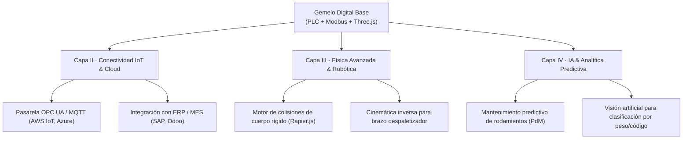

# Guía de Publicación, Despliegue y Escalabilidad · Gemelo Digital

**Proyecto:** Planta Virtual de Clasificación Gobernada por PLC (*Virtual Commissioning*)  
**Autor:** Cristian Javier Cano Mogollón  
**Tecnologías:** Three.js · Vite · Tailwind CSS · Node.js · Modbus TCP · IEC 61131-3 (CODESYS)

---

## 1. Estrategia de Portafolio Web Profesional

Este proyecto está diseñado para funcionar en **dos modalidades complementarias**, resolviendo el reto de mostrar automatización industrial e ingeniería de control en una web pública:

1. **Modo Industrial OT (On-Premise / Laboratorio SILOGE):**
   - Conexión real contra PLC físico o emulado en CODESYS mediante Modbus TCP (`127.0.0.1:502`) a través del middleware Node.js WebSocket (`:8080`).
   - Demuestra puesta en marcha virtual (*Virtual Commissioning*), desacoplamiento ISA-95 y cumplimiento riguroso de tiempos de ciclo y latencia determinista.

2. **Modo Web Showcase / Portafolio Autónomo (Despliegue Web):**
   - El cliente Three.js incorpora un **motor FSM local en JavaScript** que emula con precisión matemática la máquina de Moore del PLC IEC 61131-3.
   - Permite que cualquier reclutador, cliente, evaluador o estudiante interactúe con la planta 3D en tiempo real desde el navegador (Marcha, Parada, Seta de Emergencia, Selector de Ruta A/B, generación de paquetes y cambio de estibas) **sin necesidad de instalar software industrial ni tener un servidor Modbus corriendo**.
   - Conmutación automática: si detecta protocolo `https://` o no encuentra el middleware local tras 1.5 s, activa el modo autónomo sin arrojar errores.

---

## 2. Inicialización del Repositorio Git y Subida a GitHub

Para almacenar este proyecto en tu cuenta de GitHub y vincularlo a tu portafolio, sigue estos pasos desde la terminal:

```bash
# 1. Posicionarse en la carpeta raíz del proyecto
cd "/Users/cristianjaviercanomogollon/Documents/Proyectosv2.0/2_Operativos/modelo_digital"

# 2. Inicializar el repositorio Git
git init

# 3. Añadir todos los archivos al área de preparación (staging)
git add .

# 4. Crear el commit inicial formal
git commit -m "feat: arquitectura completa de gemelo digital con modelos 3d industriales, bpm 2.0 y soporte web showcase"

# 5. Crear la rama principal 'main'
git branch -M main

# 6. Conectar con tu repositorio remoto de GitHub (reemplaza con tu URL)
# Ejemplo: git remote add origin https://github.com/cristianjcano/planta-clasificacion-gemelo-digital.git
git remote add origin <URL_DE_TU_REPOSITORIO_GITHUB>

# 7. Subir el proyecto
git push -u origin main
```

---

## 3. Opciones de Despliegue en la Web Profesional

### Opción A · Despliegue Automatizado con GitHub Pages (Recomendado)
El proyecto ya cuenta con el flujo de trabajo configurado en [`.github/workflows/deploy-portfolio.yml`](.github/workflows/deploy-portfolio.yml).
1. En GitHub, ve a **Settings** → **Pages**.
2. En **Build and deployment** > **Source**, selecciona **GitHub Actions**.
3. Cada vez que hagas `git push origin main`, GitHub compilará automáticamente la aplicación Three.js y la publicará en:
   `https://<tu-usuario>.github.io/<nombre-del-repo>/`

### Opción B · Despliegue en Vercel con 1 Clic
El repositorio incluye [`vercel.json`](vercel.json):
1. Inicia sesión en [Vercel](https://vercel.com).
2. Haz clic en **Add New Project** e importa el repositorio de GitHub.
3. Vercel detectará automáticamente la configuración y compilará la carpeta `dist`.
4. Obtendrás una URL instantánea con certificado SSL (ej. `https://gemelo-digital-planta.vercel.app`).

### Opción C · Incrustación en tu Sitio Web / Portafolio Personal
Puedes integrar la simulación interactiva 3D directamente dentro de cualquier sección de tu página web mediante un `<iframe>` responsivo:

```html
<div class="digital-twin-container" style="position: relative; width: 100%; height: 650px; border-radius: 12px; overflow: hidden; box-shadow: 0 10px 30px rgba(0,0,0,0.15);">
  <iframe
    src="https://tu-usuario.github.io/planta-clasificacion-gemelo-digital/"
    title="Gemelo Digital Planta de Clasificación Industrial"
    style="width: 100%; height: 100%; border: none;"
    allow="accelerometer; autoplay; clipboard-write; encrypted-media; gyroscope"
    loading="lazy"
  ></iframe>
</div>
```

---

## 4. Hoja de Ruta de Escalabilidad (*Scalability Roadmap*)

Este proyecto está diseñado modularmente bajo los principios de la **Industria 4.0** y puede escalarse en 4 dimensiones estratégicas:



1. **Protocolos Industriales Avanzados (OPC UA / MQTT Sparkplug B):**
   - Extender el middleware Node.js para actuar como servidor/cliente OPC UA (IEC 62541), permitiendo la integración directa con SCADA comerciales (Ignition, Siemens WinCC, Wonderware).
2. **Física Rígida Completa en el Navegador (Rapier.js / PhysX):**
   - Sustituir la cinemática de paquetes por física rígida con fricción dinámica, aceleración centrífuga en el desvío y masa variable para simular desestabilización o vuelco de carga.
3. **Mantenimiento Predictivo con Machine Learning:**
   - Inyección de telemetría de vibración, temperatura y consumo de corriente simulados en los motores hacia modelos entrenados de detección de anomalías (Autoencoders / Random Forest) para estimar la Vida Útil Remanente (*Remaining Useful Life* - RUL).
4. **Visión por Computador en el Sensor de Entrada:**
   - Reemplazar el sensor fotoeléctrico discreto por una cámara virtual que capture la imagen de la caja, lea códigos QR/DataMatrix o clasifique el empaque mediante una red neuronal convolucional (CNN) en WebGL.
