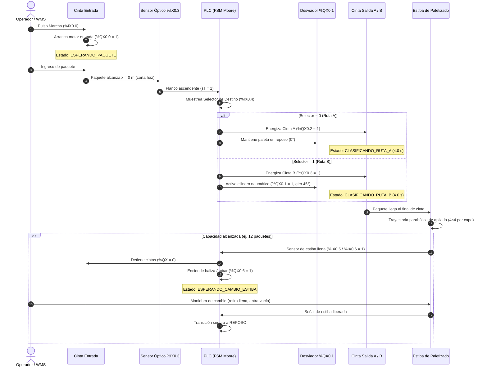
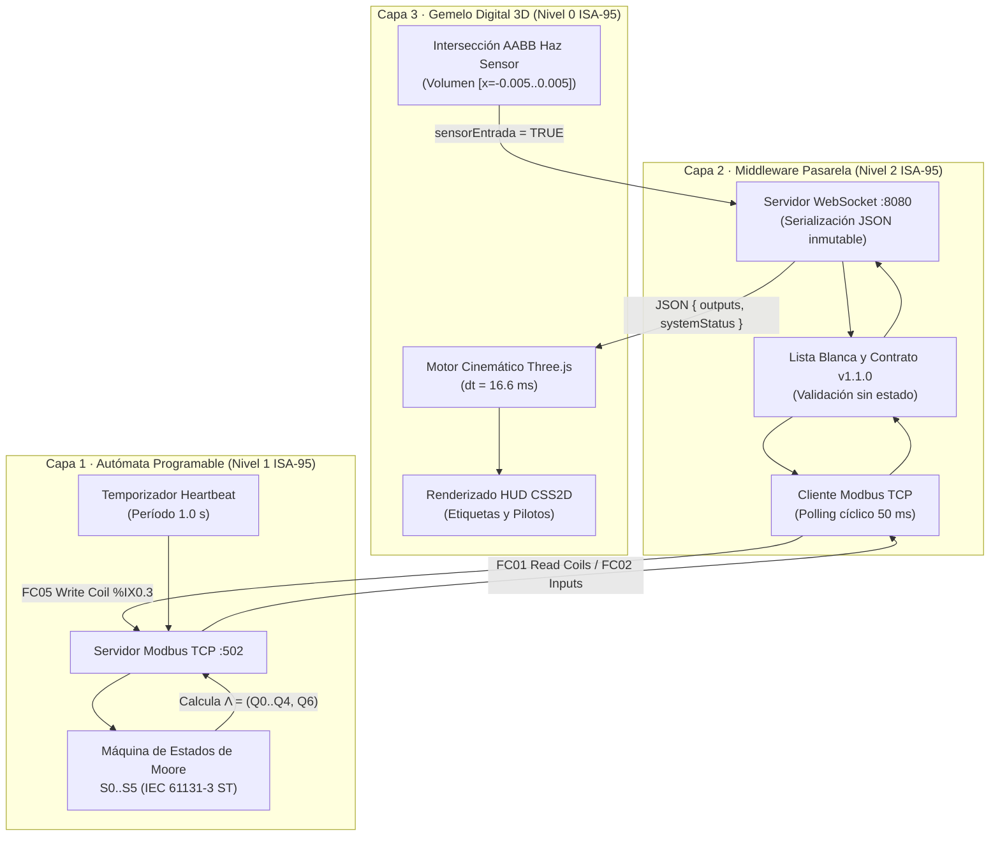
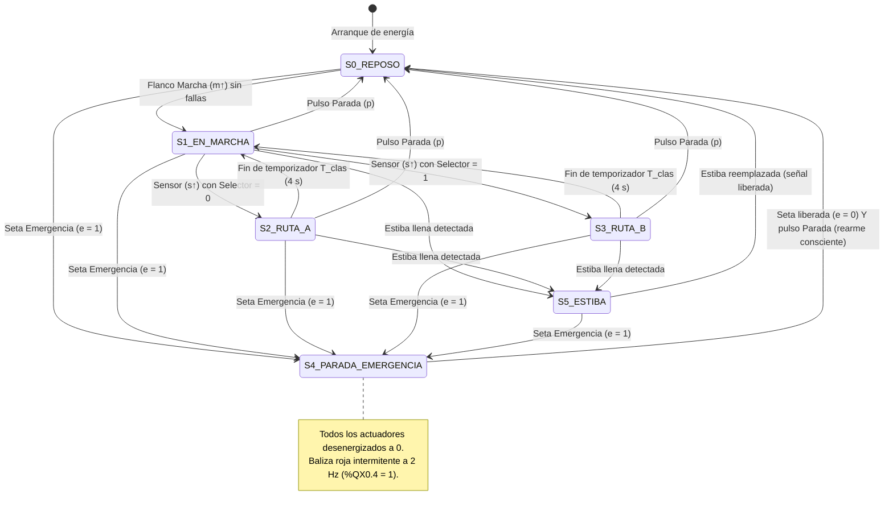

# Especificación Técnica, Modelo BPMN 2.0 y Casos de Uso · Gemelo Digital

**Proyecto:** Celda Automatizada de Clasificación y Paletizado Gobernado por PLC  
**Enfoque Metodológico:** Puesta en Marcha Virtual (*Virtual Commissioning*) e Industria 4.0  
**Autor:** Cristian Javier Cano Mogollón  
**Ubicación:** Laboratorio SILOGE / UPB

---

## 1. Resumen Ejecutivo y Ficha Técnica

El **Gemelo Digital de la Celda de Clasificación** es una plataforma ciberfísica de ingeniería que reproduce con exactitud matemática, cinemática y de control el comportamiento de una línea industrial de clasificación logística de paquetería gobernada por un Autómata Programable (PLC).

El sistema desacopla por completo la **lógica de decisión (OT)** de la **física y visualización (IT/HMI)**, cumpliendo la jerarquía estandarizada **ISA-95 / IEC 62264**:

| Parámetro | Valor de Ingeniería | Justificación / Estándar |
|---|---|---|
| **Velocidad nominal ($v_c$)** | 0.6 m/s (36 m/min) | Velocidad estándar para paquetería de comercio electrónico y centros de distribución. |
| **Altura de transporte ($h$)** | 0.80 m sobre cota cero | Altura ergonómica normalizada según directiva de maquinaria UNE-EN ISO 14738. |
| **Tiempo de clasificación ($T_{clas}$)** | 4.0 s | Temporizador $T_{clas} \geq \frac{L_d + L_s}{v_c} + \varepsilon$ que garantiza despeje total antes del próximo paquete. |
| **Estándar de programación PLC** | IEC 61131-3 (ST - Texto Estructurado) | Lenguaje determinista con autómata FSM de Moore, evaluado en tareas periódicas cíclicas. |
| **Protocolo de campo industrial** | Modbus TCP (Puerto 502 / 15020) | Funciones de estándar abierto FC01 (Read Coils), FC02 (Discrete Inputs), FC05/FC15 (Write). |
| **Motor de Renderizado 3D** | Three.js (WebGL / WebGPU PBR) | Pipeline con cálculo de sombras PCF, microtexturas de listones antideslizantes y componentes mecánicos paramétricos. |

---

## 2. Modelado de Procesos en BPMN 2.0 (OMG)

El proceso se modela en tres niveles jerárquicos: operativo logístico, bucle de control ciberfísico en tiempo real y protocolo de seguridad.

### 2.1 BPMN · Flujo Operativo y Logístico Global

Representa el ciclo de vida del material desde que ingresa al transportador de entrada hasta su consolidación en estibas de despacho.

---

### 2.2 BPMN · Bucle de Control y Puesta en Marcha Virtual (*Virtual Commissioning*)

Describe la interacción determinista entre las 3 capas cada 50 ms:

---

### 2.3 BPMN · Protocolo de Seguridad Operativa y Parada de Emergencia (ISO 13849-1)

Implementa la arquitectura de seguridad categoría 3 / PL d con rearme intencional:

---

## 3. Posibles Usos Industriales, Académicos y Comerciales

Este proyecto constituye un activo de propiedad intelectual altamente valorado por sus múltiples aplicaciones:

### 1. Puesta en Marcha Virtual (*Virtual Commissioning*) en la Industria
* **Problema:** En proyectos de automatización tradicionales, el 60-70% de los errores de software de PLC se detectan durante el montaje mecánico en planta, generando paradas costosas, daños en cilindros neumáticos y retrasos en entrega.
* **Solución del Gemelo:** Permite probar el 100% del código CODESYS / Siemens TIA Portal contra la planta virtual 3D antes de comprar el primer perfil de aluminio o motor.
* **Impacto Económico:** Reducción del **75% en tiempos de puesta en marcha física** y cero riesgo de colisiones de maquinaria.

### 2. Formación Universitaria y Capacitación Técnica de Operadores
* **Problema:** Los laboratorios físicos de PLC en universidades son limitados en cupos, costosos de mantener y conllevan riesgos de electrocución o atrapamiento mecánico para estudiantes principiantes.
* **Solución del Gemelo:** Plataforma interactiva en navegador donde los estudiantes programan algoritmos en lenguaje escalera (LADDER) o texto estructurado (ST) y ven cómo su código mueve físicamente la planta virtual.
* **Impacto Pedagógico:** Capacidad de impartir laboratorios remotos 24/7 a cientos de alumnos simultáneamente.

### 3. Banco de Ensayos para Algoritmos de Inteligencia Artificial y Machine Learning
* **Optimización Logística:** Entrenamiento de agentes de Aprendizaje por Refuerzo (*Reinforcement Learning*) para balancear dinámicamente la carga entre las estibas A y B según la tasa de llegada de paquetes.
* **Mantenimiento Predictivo (PdM):** Generación de datos sintéticos de falla (atascos inducidos, degradación térmica de bobinados, pérdida de presión neumática) para entrenar clasificadores de fallas operativas antes de desplegarlos en producción.

### 4. Centros de Distribución y Fulfillment E-Commerce (Logística 4.0)
* **Validación de Capacidad:** Simulación de cuellos de botella mediante variación paramétrica de la velocidad de banda ($v_c$), tiempo de maniobra de palets y cálculo en vivo del OEE (*Overall Equipment Effectiveness*).
* **Diseño Ergonométrico:** Evaluación de zonas de desvío y acumulación para paquetería de diferentes formatos (cajas, sobres, paquetes frágiles).

### 5. Ciberseguridad en Redes Operacionales (Ciberseguridad OT / ICS)
* **Auditoría de Protocolos:** Evaluación de vulnerabilidades en el protocolo Modbus TCP (inyección de tramas falsas, ataques de denegación de servicio DoS al puerto 502, alteración no autorizada de Coils).
* **Desarrollo de Sistemas de Detección de Intrusos (IDS Industrial):** Validación de algoritmos que detectan anomalías de tráfico comparando el estado reportado por Modbus con la cinemática física esperada del gemelo digital.

### 6. Showroom Interactivo y Portafolio de Consultoría de Ingeniería
* **Herramienta Comercial de Preventa:** Los integradores de sistemas y consultores pueden presentar a clientes industriales una maqueta virtual 3D interactiva en tiempo real sobre su propuesta de automatización, facilitando el cierre de contratos llave en mano (*Turnkey Projects*).
