# 🏭 Gemelo Digital de Celda de Clasificación Industrial Gobernado por PLC
### *Virtual Commissioning · IEC 61131-3 · Modbus TCP · Three.js PBR · Industria 4.0*

[](https://threejs.org/)
[](https://vitejs.dev/)
[](https://modbus.org/)
[](https://www.codesys.com/)
[](.)
[](https://opensource.org/licenses/ISC)

> **Autor:** Cristian Javier Cano Mogollón  
> **Laboratorio:** SILOGE — Universidad Pontificia Bolivariana (UPB)

---

## 🌟 Resumen del Proyecto

Este repositorio contiene un **Gemelo Digital Ciberfísico Completo** de una planta industrial de clasificación y paletizado de paquetería logística bajo el paradigma de **Puesta en Marcha Virtual (*Virtual Commissioning*)**.

El sistema desacopla estrictamente los niveles de la pirámide de automatización **ISA-95 / IEC 62264**:
- **Nivel 1–2 (OT / Control):** Máquina de Estados Finitos de Moore (`S0..S7`) evaluada en tiempo determinista (Texto Estructurado ST en **CODESYS V3.5** o runtime emulado en Node.js), con cierre de lazo por fotoceldas de descarga (`%IX0.7`, `%IX1.0`), indexador neumático de admisión (`%QX0.7`), ruteo multimodo (`Escáner SKU`, `Auto-Balanceo`, `Manual`), Watchdog de atasco (`S6 · FALLA_ATASCO`) y estación de inspección `NO_READ` (`S7 · INSPECCION_NO_READ`).
- **Nivel 2 (Middleware):** Pasarela de integración **Modbus TCP $\leftrightarrow$ WebSocket** con soporte completo de las **4 tablas estándar Modbus (`FC01/05 Coils`, `FC02 Discrete Inputs`, `FC03/06 Holding Registers`, `FC04 Input Registers`)** y contrato de datos inmutable **v1.2.0**.
- **Nivel 0–1 (IT / Cinemática, Sorting, Paletizado 4 Niveles y HMI 3D):** Renderizador interactivo en tiempo real con **Three.js** con modelos paramétricos PBR de alta fidelidad mecánica, catálogo de **4 formatos físicos de paquetes 3D** (`Express 3.5 kg`, `Frágil 6.0 kg`, `Estándar 11.5 kg`, `Pesado 18.0 kg` + `NO_READ`) con reglas de sorting conmutables (**Por Prioridad/Tipo** o **Por Báscula Dinámica de Peso**), **paletizado de 4 niveles completos (64 cajas por estiba, 16 cajas por cama 4×4)**, barra de **KPIs Ejecutivos B2B** (`Throughput cajas/h`, `kg despachados`, `Calidad OEE %`) y el panel pedagógico **«Rayos X del PLC»** (animación del ciclo de scan en 3 pasos + 3 peldaños de Lógica de Escalera iluminados en vivo).

---

## 🚀 Doble Modo de Ejecución (OT Real vs. Web Showcase)

Para permitir su exhibición tanto en entornos de laboratorio como en portafolios web públicos:

1. **Modo Industrial OT:** Conexión a `ws://localhost:8080` comunicándose con CODESYS Control Win V3 vía Modbus TCP (`127.0.0.1:502`).
2. **Modo Web Showcase Autónomo:** El cliente web incluye un **motor FSM local IEC 61131-3 en JavaScript**. Si la aplicación se abre en la web (GitHub Pages, Vercel o HTTPS), la FSM se ejecuta en el navegador con el mismo rigor matemático, permitiendo interactuar con pulsadores, emergencia, ruteo y estibas sin instalar software adicional.

---

## 📐 Especificación y Modelos de Proceso BPMN 2.0

La ingeniería formal, ecuaciones diferenciales y especificación de procesos BPMN se detallan en:
- 📖 [**Especificación y Modelos BPMN 2.0**](ESPECIFICACION_Y_BPMN_PROYECTO.md)
- 🚀 [**Guía de Publicación y Despliegue en Portafolio**](DEPLOY_PORTAFOLIO.md)
- 🏗️ [**Catálogo de Modelos y Componentes 3D**](planta-clasificacion-gemelo-digital/modelos_3d/README.md)
- 📑 [**Arquitectura de Tres Capas y Flujos de Datos**](Arquitectura_y_flujos.md)

```mermaid
flowchart LR
  subgraph C3["C3 · HMI / SCADA 3D (Three.js)"]
    K3["Cinemática + Paletizado 4 Niveles (64 cajas)"]
    SENS["Sorting Multiformato + Sensores AABB"]
    HUD["Rayos X del PLC + KPIs B2B + Panel Mando"]
  end
  subgraph C2["C2 · Middleware Node.js"]
    WSS["Servidor WebSocket :8080"]
    CONTRATO["Contrato de Datos v1.2.0"]
    MBC["Cliente Modbus TCP (Polling 50 ms)"]
  end
  subgraph C1["C1 · PLC (CODESYS / Virtual)"]
    SLV["Esclavo Modbus TCP :502"]
    FSM["FSM Clasificador Moore S0..S7 (ST)"]
    HB["Heartbeat + Watchdog TON"]
  end

  C3 <-->|"JSON / WebSocket"| C2
  C2 <-->|"Modbus TCP (FC01, FC02, FC03, FC04, FC05, FC06)"| C1
```



---

## 🛠️ Instalación y Puesta en Marcha Local

### Requisitos
- **Node.js:** $\ge$ 20.19.0 (Recomendado Node 22 LTS).
- **Git**

### Pasos Rápidos

```bash
cd planta-clasificacion-gemelo-digital

# 1. Instalar dependencias
cd plc-virtual && npm install && cd ..
cd puente-modbus-planta && npm install && cp .env.example .env && cd ..
cd hmi-planta-3d && npm install && cd ..

# 2. Iniciar simulación completa (PLC + Middleware + HMI 3D)
./iniciar.sh
# Se abrirá automáticamente http://localhost:5173 en tu navegador
```

### Ejecución de Pruebas Unitarias y de Integración
El proyecto cuenta con una cobertura integral de pruebas automatizadas:
```bash
# Pruebas del PLC virtual (Casos CP-01 a CP-19)
cd plc-virtual && npm test

# Pruebas del middleware y contrato Modbus
cd ../puente-modbus-planta && npm test

# Pruebas de cinemática y sincronización 3D
cd ../hmi-planta-3d && npm test
```

---

## 🎯 Casos de Uso y Aplicaciones Industriales

1. **Virtual Commissioning Industrial:** Reducción del 75% en tiempos de puesta en marcha física y validación previa de código PLC.
2. **Capacitación Universitaria y Técnica:** Formación en automatización industrial 24/7 sin riesgo de daño en equipos o accidentes.
3. **Optimización Logística e Industria 4.0:** Validación de tasas de flujo, cuellos de botella y balanceo de carga en centros de distribución.
4. **Plataforma de I+D para IA y Mantenimiento Predictivo:** Algoritmos de visión artificial para clasificación y detección de fallas térmicas/vibracionales.
5. **Auditoría de Ciberseguridad OT:** Detección de intrusiones y manipulación en redes Modbus TCP industriales.

---

## 📄 Licencia

Distribuido bajo licencia **ISC**. Desarrollado con fines académicos, de investigación y demostración profesional.
