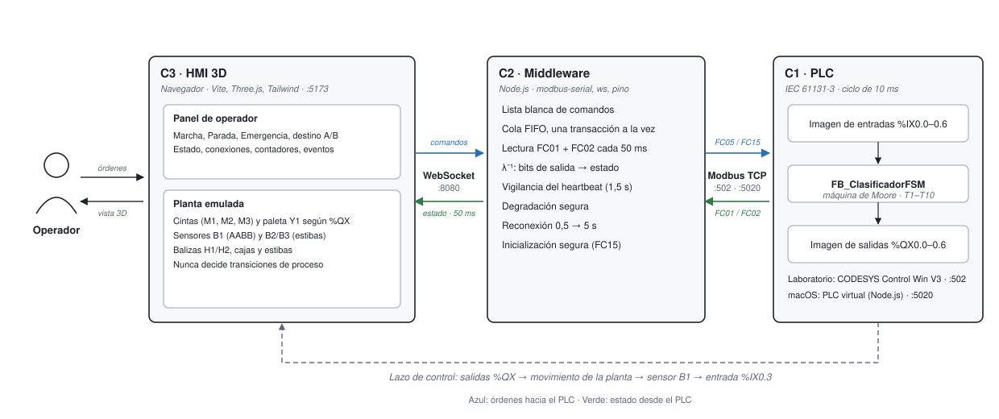
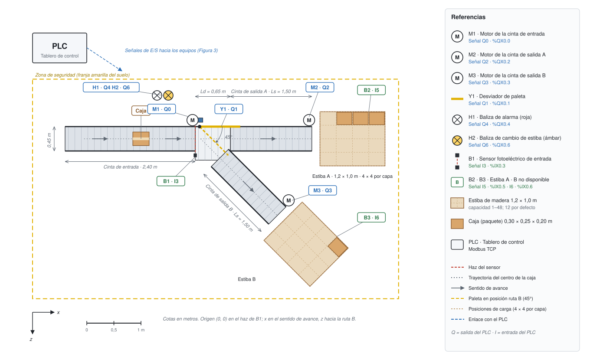
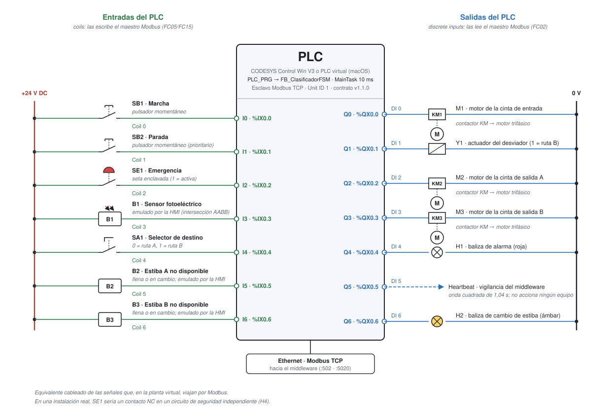
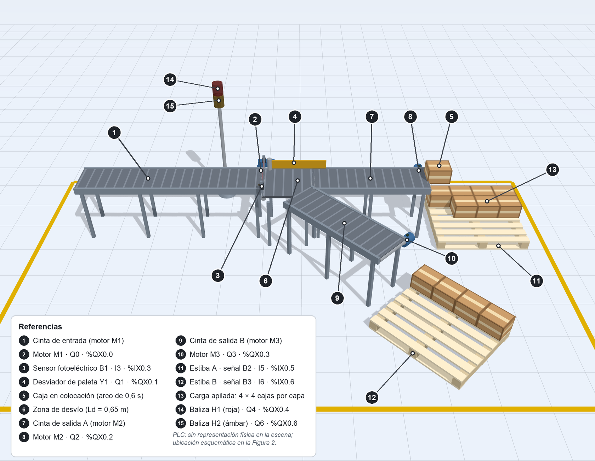
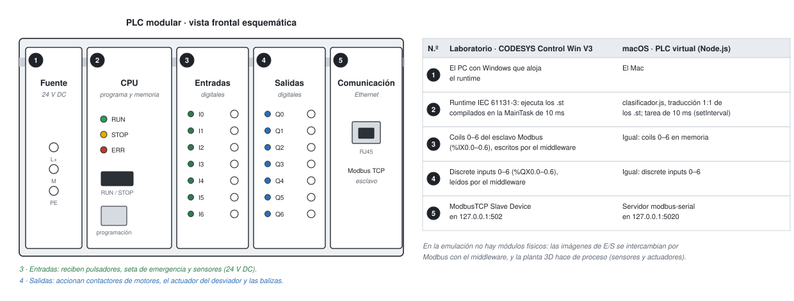
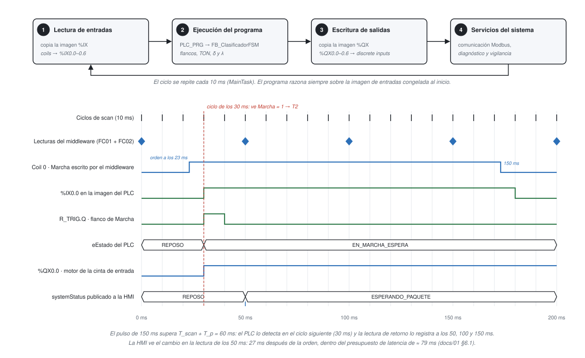
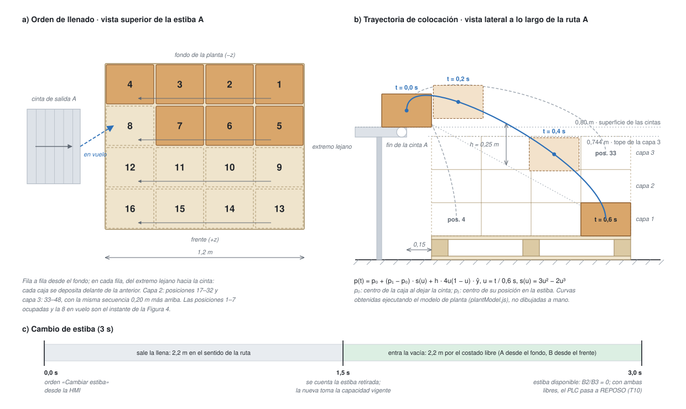

# 03 · Manual de puesta en marcha

> Documento incremental. Plataforma de desarrollo: *macOS*, con el PLC virtual de `plc-virtual/`. El procedimiento del laboratorio SILOGE (Windows + CODESYS) está en `windows/README.md`. Secciones vigentes: esquema del sistema, el PLC y su emulación, capa de control (§2–3, Fase 2), middleware (§4, Fase 3) y HMI 3D con estibas (§5, Fase 4 y parte implementada de la Fase 5). La operación diaria de la planta se describe en `06_manual_de_operacion.md`.

## Esquema del sistema

Antes de la puesta en marcha conviene identificar cada elemento de la planta y su relación con el PLC. Las figuras 1 a 3 y 5 a 7 se generan con `python3 docs/figuras/generar_figuras.py` a partir del código: la geometría sale de `hmi-planta-3d/src/core/plantModel.js` y las trayectorias de la Figura 7 se obtienen ejecutando ese mismo modelo, de modo que las figuras se mantienen fieles a la planta si esta cambia. La Figura 4 es una captura anotada de la HMI.

### Identificación de equipos

Las referencias siguen la convención habitual de los esquemas eléctricos: *M* para motores, *Y* para actuadores, *H* para señalización, *B* para sensores, *S* para pulsadores y selectores, y *KM* para contactores. Las coordenadas se miden en metros desde el haz del sensor B1, con *x* en el sentido de avance y *z* hacia la ruta B.

| Ref. | Equipo | Señal del PLC | Modbus | Ubicación (x, z) en m |
|---|---|---|---|---|
| PLC | Controlador programable en el tablero de control | — | Esclavo TCP, Unit ID 1, puerto 502 (CODESYS) o 5020 (PLC virtual) | Fuera de la línea; sin representación física en la escena 3D |
| M1 | Motor de la cinta de entrada; arrastra también la zona de desvío | Q0 · `%QX0.0` | DI 0 | (−0,05; −0,35), extremo de descarga |
| Y1 | Desviador de paleta: 0° para la ruta A, 45° para la ruta B | Q1 · `%QX0.1` | DI 1 | Pivote en (0,08; −0,23) |
| M2 | Motor de la cinta de salida A | Q2 · `%QX0.2` | DI 2 | (2,10; −0,35) |
| M3 | Motor de la cinta de salida B | Q3 · `%QX0.3` | DI 3 | (1,72; 1,14) |
| H1 | Baliza de alarma, módulo rojo (destello a 2 Hz) | Q4 · `%QX0.4` | DI 4 | (−0,60; −0,80), módulo superior |
| — | Heartbeat (sin equipo asociado) | Q5 · `%QX0.5` | DI 5 | — |
| H2 | Baliza de cambio de estiba, módulo ámbar (destello a 1 Hz) | Q6 · `%QX0.6` | DI 6 | (−0,60; −0,80), módulo inferior |
| B1 | Sensor fotoeléctrico de entrada (emisor y reflector) | I3 · `%IX0.3` | Coil 3 | Haz en x = 0, entre z = −0,31 y z = 0,31 |
| B2 | Sensor de estiba A no disponible (llena o en cambio) | I5 · `%IX0.5` | Coil 5 | En la estiba A |
| B3 | Sensor de estiba B no disponible (llena o en cambio) | I6 · `%IX0.6` | Coil 6 | En la estiba B |
| SB1, SB2, SE1, SA1 | Marcha, Parada, Emergencia y selector de destino | I0, I1, I2, I4 | Coils 0, 1, 2, 4 | Panel de operador de la HMI |
| — | Estibas A y B de 1,2 × 1,0 × 0,144 m | — | — | Centros en (2,90; 0,00) y (2,05; 1,95) |
| — | Cinta de entrada · zona de desvío · salida A · salida B | — | — | x de −2,40 a 0 · de 0 a 0,65 · de 0,65 a 2,15 · desde (0,45; 0,35) a 45°, 1,50 m |
| — | Caja (paquete) de 0,30 × 0,25 × 0,20 m | — | — | Se genera en x = −2,20 |

Figura 1

*Arquitectura de tres capas del sistema*



*Nota.* El PLC es CODESYS Control Win V3 en el laboratorio y el PLC virtual en macOS; ambos exponen el mismo esclavo Modbus. La línea discontinua inferior representa el lazo de control: las salidas del PLC mueven la planta emulada, y los sensores B1, B2 y B3 devuelven su estado a las entradas `%IX0.3`, `%IX0.5` y `%IX0.6`.

Figura 2

*Vista superior a escala de la planta de clasificación*



*Nota.* 125 px por metro; la barra inferior da la escala. La ubicación del tablero del PLC es esquemática. Las etiquetas indican la referencia del equipo y su señal del PLC: en azul las salidas (Q) y en verde las entradas (I). La línea discontinua amarilla de la paleta muestra su posición de trabajo para la ruta B. Cada estiba muestra su retícula de 4 × 4 posiciones por capa, con algunas cajas de ejemplo.

Figura 3

*Conexiones de entradas y salidas del PLC*



*Nota.* Es el equivalente cableado de las señales que, en la planta virtual, viajan por Modbus: cada entrada es un coil que escribe el middleware y cada salida un discrete input que este lee (`02_mapeo_memoria_modbus.md` §3). En la planta modelada, la seta SE1 usa lógica positiva (1 = emergencia activa); una instalación real requiere un contacto NC en un circuito de seguridad independiente del PLC (hipótesis H4).

Figura 4

*Vista isométrica de la planta en la HMI 3D con los equipos identificados*



*Nota.* Captura de la HMI en la vista inicial de la cámara. La estiba A tiene 7 cajas y la octava está en el aire, a mitad de su arco de colocación (t ≈ 0,28 s de 0,6 s); la estiba B tiene 4. La caja en vuelo es real: se envió por la ruta A con el PLC en marcha y el modelo se congeló en ese instante. La posición de cada referencia se obtuvo proyectando las coordenadas 3D del equipo con la misma cámara de la escena.

## El PLC: qué es, cómo se configura y cómo lo emula esta aplicación

Toda la planta gira en torno a un controlador cuyo programa no sabe si sus entradas llegan por cables o por una red, ni si sus salidas mueven motores reales o un modelo 3D. Entender qué hace ese controlador, cómo se prepara y qué parte de él reproduce esta aplicación es la base para interpretar cualquier prueba de puesta en marcha. Esta sección lo explica en términos prácticos; el tratamiento formal (ciclo de scan, máquina de Moore, flancos, temporizadores y propiedades de seguridad) está en `07_fundamentos_teoricos.md` §4.

### Qué es un PLC

Un *controlador lógico programable, PLC,* es un computador industrial diseñado para gobernar máquinas y procesos: lee señales de pulsadores y sensores, ejecuta un programa almacenado y acciona contactores, válvulas o balizas. La norma IEC 61131-1 describe su estructura funcional: una fuente de alimentación, una unidad de procesamiento que ejecuta el programa, interfaces con los sensores y actuadores, funciones de comunicación y funciones de programación y prueba (International Electrotechnical Commission [IEC], 2003). A diferencia de un computador de oficina, un PLC repite su programa de forma cíclica con un periodo acotado, trabaja con señales eléctricas industriales (típicamente 24 V DC) y está construido para años de servicio continuo en planta.

La Figura 6 muestra la forma más común, el PLC modular, junto a su equivalente en esta aplicación. La fuente alimenta el bastidor; la *unidad central de procesamiento, CPU,* guarda y ejecuta el programa y tiene un selector RUN/STOP; el módulo de entradas convierte cada señal de 24 V en un bit (I0…I6), el de salidas convierte cada bit en una señal que energiza un contactor o una lámpara (Q0…Q6), y el de comunicación conecta el controlador con otros equipos por Ethernet.

Figura 6

*Anatomía de un PLC modular y su equivalente en la simulación*



*Nota.* La numeración de los módulos coincide con la de las filas de la tabla. En la emulación no hay módulos de E/S físicos: el módulo de comunicación hace de puerta única por la que entran y salen todas las señales.

El software de un PLC se organiza según la norma IEC 61131-3 (IEC, 2013; John & Tiegelkamp, 2010). Una *configuración* contiene uno o más *recursos* (unidades de procesamiento); cada recurso ejecuta *tareas*, y cada tarea llama a *programas*. El código se escribe en *unidades de organización del programa, POU,* de tres clases: programas, *bloques de función, FB,* que conservan su memoria entre llamadas (un temporizador debe recordar cuándo empezó a contar) y funciones, que no la conservan. Las variables tienen tipo y pueden ligarse a una dirección de la imagen de proceso: `%I` para entradas, `%Q` para salidas y `%M` para memoria interna, con un prefijo de tamaño (`X` bit, `B` byte, `W` palabra). Así, `%IX0.3` se lee como *entrada, bit, byte 0, bit 3*. La norma define los lenguajes de texto estructurado (ST), diagrama de contactos (LD), diagrama de bloques de función (FBD) y gráfico secuencial de funciones (SFC); la lista de instrucciones (IL) quedó declarada obsoleta en la edición de 2013. Este proyecto usa texto estructurado.

### El ciclo de scan

Un PLC no reacciona a las señales en el instante en que cambian: las observa en ciclos. En cada ciclo de la tarea copia las entradas a una imagen de proceso, ejecuta el programa sobre esa imagen congelada, copia la imagen de salidas a los actuadores y atiende sus servicios internos, entre ellos la comunicación (John & Tiegelkamp, 2010). La Figura 5 muestra esas cuatro fases y lo que ocurre, ciclo a ciclo, cuando el operador pulsa Marcha en la HMI.

Figura 5

*Ciclo de scan del PLC y diagrama temporal de una orden de Marcha*



*Nota.* La orden llega a los 23 ms, entre dos ciclos; el PLC no la ve hasta el ciclo de los 30 ms. El flanco (R_TRIG) dura exactamente un ciclo, aunque Marcha siga en 1 durante 150 ms. La HMI conoce el cambio en la siguiente lectura del middleware, a los 50 ms.

De esa disciplina se derivan cuatro consecuencias que el programa de esta planta tiene en cuenta. Primera, el programa razona sobre un estado coherente: ninguna entrada cambia a mitad de su ejecución. Segunda, un evento más corto que el ciclo puede pasar inadvertido; por eso los pulsadores se emulan con pulsos de 150 ms (hipótesis H2). Tercera, un pulsador que se mantiene pulsado está en 1 durante muchos ciclos, así que la orden se toma del flanco de subida y no del nivel; de lo contrario, Marcha mantenida rearrancaría la línea tras una emergencia (propiedad P4). Cuarta, los temporizadores miden tiempo real a través de los ciclos, no número de ciclos.

La Tabla 1 muestra esas reglas en acción. Se obtuvo ejecutando `FB_ClasificadorFSM` de `plc-virtual/src/clasificador.js` con ciclos de 10 ms y entradas sintéticas: Marcha entre 30 y 180 ms, selector en la ruta B, sensor ocupado entre 500 y 900 ms y estiba B no disponible entre 5 y 9 s. Solo se listan los ciclos en los que algo cambia.

Tabla 1

*Traza ciclo a ciclo del bloque de función del clasificador*

| Ciclo k | t (ms) | Entradas I0…I6 | Flanco de Marcha | Flanco del sensor | ET del TON (ms) | Estado tras el ciclo | Salidas Q0…Q4 · Q6 | Qué ocurre |
|--:|--:|:-:|:-:|:-:|--:|---|:-:|---|
| 0 | 0 | 0000100 | 0 | 0 | 0 | `REPOSO` | 00000 · 0 | Arranque en el estado seguro; selector en B |
| 3 | 30 | 1000100 | 1 | 0 | 0 | `EN_MARCHA_ESPERA` | 10000 · 0 | Primer ciclo que ve Marcha: flanco y T2 |
| 4 | 40 | 1000100 | 0 | 0 | 0 | `EN_MARCHA_ESPERA` | 10000 · 0 | Marcha sigue en 1, pero ya no hay flanco |
| 50 | 500 | 0001100 | 0 | 1 | 0 | `CLASIFICANDO_RUTA_B` | 11010 · 0 | Flanco del sensor con el selector en B: T5 |
| 51 | 510 | 0001100 | 0 | 0 | 0 | `CLASIFICANDO_RUTA_B` | 11010 · 0 | El temporizador arranca: ve el estado nuevo un ciclo después |
| 90 | 900 | 0000100 | 0 | 0 | 390 | `CLASIFICANDO_RUTA_B` | 11010 · 0 | El sensor se libera: sin efecto; el temporizador sigue |
| 451 | 4510 | 0000100 | 0 | 0 | 4000 | `EN_MARCHA_ESPERA` | 10000 · 0 | El temporizador cumple 4 s: T6 |
| 500 | 5000 | 0000101 | 0 | 0 | 0 | `ESPERANDO_CAMBIO_ESTIBA` | 00000 · 1 | Estiba B no disponible: T9; cintas paradas y baliza ámbar |
| 900 | 9000 | 0000100 | 0 | 0 | 0 | `REPOSO` | 00000 · 0 | Estiba repuesta: T10; la línea espera un flanco nuevo de Marcha |

*Nota.* Bits en el orden de las direcciones: I0 Marcha, I1 Parada, I2 Emergencia, I3 Sensor, I4 Selector, I5 y I6 estibas A y B. Q5, el heartbeat, se omite. ET es el tiempo transcurrido del temporizador de clasificación.

El ciclo 51 ilustra un detalle que solo se entiende con el modelo de ciclos. El bloque evalúa primero el temporizador, con el estado vigente, y después la transición (orden (a)…(e) de `logica_clasificador_fsm.st`). En el ciclo 50 el temporizador todavía ve `EN_MARCHA_ESPERA`; empieza a contar en el ciclo 51. Por eso la transición T6 llega un ciclo más tarde de lo que sugiere el parámetro:

$$
t_{T6} = t_{T5} + T_{scan} + T_{clas} = 500 + 10 + 4000 = 4510\ \text{ms}
$$

Un ciclo de diferencia es irrelevante frente al margen de 0,17 s del dimensionamiento de $T_{clas}$ (§5.1), pero es exactamente el tipo de efecto que una puesta en marcha virtual debe hacer visible antes de llegar a la planta real.

### Cómo se configura un PLC

Configurar un PLC es describirle al entorno de programación qué controlador hay, qué señales tiene, cada cuánto debe ejecutar cada programa y con quién se comunica; después se escribe el programa, se compila, se descarga y se pone en RUN. La Tabla 2 recorre esos pasos con los valores de este proyecto en CODESYS; el procedimiento con los menús exactos está en `windows/README.md` §3.

Tabla 2

*Pasos de configuración de un PLC y su concreción en este proyecto*

| Paso | Qué se define | En este proyecto |
|---|---|---|
| 1. Dispositivo | El controlador de destino y su runtime | CODESYS Control Win V3 x64: un PLC por software sobre el PC con Windows |
| 2. Tareas | Qué programas se ejecutan, cada cuánto y con qué prioridad | `MainTask`, cíclica de 10 ms (hipótesis H3), que llama a `PLC_PRG` |
| 3. Tipos de datos | Tipos propios del proyecto | Enumeración `E_EstadoClasificador` con los estados S0 a S5 |
| 4. Variables y asignación de E/S | Variables globales y su dirección en la imagen de proceso | `GVL_IO` con `AT %IX0.0`…`%IX0.6` y `AT %QX0.0`…`%QX0.6`; constantes en `GVL_Param`: `T_CLASIFICACION` = 4 s y `T_HEARTBEAT` = 500 ms |
| 5. Unidades de organización del programa | Programas y bloques de función | `FB_Heartbeat`, `FB_ClasificadorFSM` y `PLC_PRG`, que es la capa de cableado y la única POU que toca `GVL_IO` |
| 6. Comunicaciones | Protocolos y áreas de memoria compartidas | Esclavo Modbus TCP en 127.0.0.1:502, Unit ID 1, 7 coils y 7 discrete inputs, ciclo de bus `MainTask` (`plc-codesys/config_modbus_slave.json`) |
| 7. Compilación, descarga y RUN | Traducir el programa, cargarlo en el controlador y arrancarlo | Generar código (F11), iniciar sesión (Alt+F8) e inicio (F5) |
| 8. Supervisión en línea | Ver y forzar variables con el programa en ejecución | `PLC_PRG.fbClasificador.eEstado` en vivo; forzado (F7) y liberación (Alt+F7) |

El paso 4 es el que une el programa con el mundo exterior. Cada variable de entrada se declara sobre la dirección del bit que le corresponde, y el esclavo Modbus del paso 6 se configura para que su área de coils empiece en `%IX0.0` y la de discrete inputs en `%QX0.0`. Con esa coincidencia, cuando el middleware escribe el coil 3, el programa encuentra el valor en `Sensor_Entrada`; cuando el programa escribe `Senal_Cambio_Estiba`, el middleware lo lee en el discrete input 6:

```
VAR_GLOBAL
    Sensor_Entrada      AT %IX0.3 : BOOL;  (* Coil 3 · presencia emulada por la HMI *)
    Estiba_Llena_A      AT %IX0.5 : BOOL;  (* Coil 5 · estiba A no disponible *)
    Motor_Cinta_Entrada AT %QX0.0 : BOOL;  (* DI 0 *)
    Senal_Cambio_Estiba AT %QX0.6 : BOOL;  (* DI 6 · baliza ámbar *)
END_VAR
```

Separar la capa de cableado (`PLC_PRG`) de la lógica (`FB_ClasificadorFSM`) tiene una consecuencia práctica: el bloque de función no conoce ninguna dirección, de modo que puede probarse aislado o trasladarse a otro controlador cambiando solo el cableado.

### Cómo lo emula esta aplicación

La emulación ocurre en dos niveles. En el laboratorio, CODESYS Control Win V3 ya es un PLC por software, *soft-PLC*: el runtime IEC 61131-3 se ejecuta como un proceso del PC y corre el mismo programa que correría en un controlador físico, pero no tiene módulos de E/S. Su imagen de proceso se intercambia por Modbus TCP con el middleware, y la planta, con sus sensores y actuadores, es el modelo 3D. Ese montaje, la lógica real de control frente a una planta simulada, es lo que la literatura llama *puesta en marcha virtual* (Lee & Park, 2014).

En macOS no existe CODESYS, y `plc-virtual/` emula también el runtime. No interpreta los `.st`: contiene su traducción línea a línea a JavaScript, con los mismos nombres, el mismo orden de evaluación y un esclavo Modbus con el mismo mapa de memoria. La Tabla 3 empareja cada concepto de la norma con su realización en ambos controladores.

Tabla 3

*Conceptos de IEC 61131-3 en el laboratorio y en el PLC virtual*

| Concepto | CODESYS (laboratorio) | PLC virtual (`plc-virtual/src/`) |
|---|---|---|
| Tarea cíclica | `MainTask`, 10 ms, planificada por el runtime | `#programar()` en `plcVirtual.js`: cada ciclo se programa sobre la marca ideal k·10 ms |
| Lectura de entradas | El ciclo de bus copia los coils a `%IX0.0–0.6` | `#cicloScan()` copia los 7 coils a un arreglo al inicio del ciclo |
| Programa | `PLC_PRG` | El cuerpo de `#cicloScan()`, con las mismas asignaciones |
| Bloques de función propios | `FB_Heartbeat`, `FB_ClasificadorFSM` | Clases homónimas en `clasificador.js`, con su orden (a)…(e) |
| Bloques estándar | `TON` y `R_TRIG` de la biblioteca Standard | `iec61131.js`; `TON` mide el tiempo con el reloj monotónico `performance.now()` |
| Tipos y constantes | DUT `E_EstadoClasificador`, GVL `GVL_Param` | Objetos inmutables (`Object.freeze`) con los mismos valores |
| Escritura de salidas | `%QX0.0–0.6` → discrete inputs | Arreglo de 7 discrete inputs escrito al final del ciclo |
| Esclavo Modbus TCP | ModbusTCP Slave Device, 127.0.0.1:502 | `ServerTCP` de modbus-serial, 127.0.0.1:5020; una dirección fuera del contrato responde la excepción 02 |
| STOP / RUN | Mandos del runtime | `stop` y `run` en la terminal del PLC: el esclavo sigue respondiendo con la última imagen y el heartbeat se congela |
| Supervisión en línea | Valores en vivo y forzado | Registro de cada orden recibida, cada transición y cada falla de coherencia |

El lazo se cierra en la HMI. El PLC solo ve bits: la HMI calcula si una caja corta el haz de B1 (intersección de cajas alineadas con los ejes, §5), decide si cada estiba está disponible (B2, B3) y envía esos estados como coils; en sentido inverso, convierte Q0, Q2 y Q3 en movimiento de las cintas, Q1 en el giro de la paleta y Q4 y Q6 en los destellos de la baliza (Figura 1). Para el programa, la diferencia entre un sensor cableado y uno emulado no existe.

La equivalencia de ambos controladores no se supone: se comprueba. El protocolo CP-01…CP-19 (§3) actúa como maestro Modbus y se ejecuta sin cambios contra los dos; si una modificación de los `.st` no se replica en JavaScript, alguna prueba falla.

*Medición de la tarea en macOS.* Un temporizador de JavaScript no es un planificador de tiempo real. Con `setInterval` de 10 ms, cada disparo acumulaba el retraso del anterior y el periodo medio medido en el Mac de desarrollo era de 11,78 ms. Desde el 2026-10-23, cada ciclo se programa sobre la marca ideal k·10 ms, de modo que un ciclo tardío se compensa con el siguiente. Medición del mismo día, 20 s con el esclavo Modbus activo: 1998 ciclos, periodo medio 10,000 ms, mediana 10,09 ms, 99 % de los ciclos por debajo de 12,16 ms y máximo de 14,38 ms. El diseño tolera esa dispersión: los pulsos de 150 ms superan con holgura el ciclo más largo, el temporizador de clasificación mide tiempo de reloj y no número de ciclos, y el heartbeat (1040 ms nominales) queda lejos del umbral de vigilancia de 1500 ms.

*Límites de la emulación.*

- *Sin compilación de los `.st`:* un error de sintaxis o de tipos solo aparece al generar código en CODESYS (F11).
- *Sin tiempo real estricto:* el PLC virtual corre sobre un sistema operativo de propósito general y no tiene vigilancia de desbordamiento de ciclo. CODESYS Control Win también se ejecuta sobre un sistema operativo de propósito general.
- *Señales ideales:* no hay rebotes de contactos, cables cortados ni fallas eléctricas; B1 detecta con precisión geométrica.
- *Supervisión reducida:* no hay forzado de variables; su equivalente es escribir coils desde la consola (§4.1) o desde la HMI.

## 1. Prerrequisitos

- macOS (Apple Silicon o Intel) o Linux.
- Node.js 22 LTS (mínimo 20.19, requerido por Vite 8) y npm ≥ 10.
- Navegador con WebGL 2 (Chrome, Edge, Firefox o Safari actualizados).
- `node_modules/` contiene binarios nativos por sistema operativo (p. ej., Vite 8): ejecutar `npm install` en cada máquina y no copiar esa carpeta entre macOS y Windows.
- El árbol del repositorio ya está creado; `scaffold.sh` solo se usa para generar uno nuevo (`windows/scaffold.ps1` en Windows).

## 2. Capa de control en macOS — PLC virtual

CODESYS V3.5 y CODESYS Control Win solo existen para Windows. En macOS, `plc-virtual/` sustituye a la capa C1 respetando el contrato v1.1.0:

| Aspecto | CODESYS (laboratorio, `windows/`) | `plc-virtual/` (macOS) |
|---|---|---|
| Lógica | `plc-codesys/logica_clasificador_fsm.st` | `src/clasificador.js`: traducción 1:1 (mismos nombres, orden (a)…(e), T1–T10) |
| Ciclo | `MainTask` cíclica, 10 ms | Tarea de 10 ms sobre la marca ideal k·T_scan: imagen de entradas → `PLC_PRG` → imagen de salidas |
| Mapa Modbus | Coils 0–6 → `%IX0.0–0.6`; DI 0–6 ← `%QX0.0–0.6` | Idéntico; direcciones fuera del contrato → excepción 02 |
| Enlace | `127.0.0.1:502`, Unit ID 1 | `127.0.0.1:5020`, Unit ID 1 |

*Por qué 5020.* macOS solo deja abrir puertos < 1024 sin privilegios cuando se escucha en todas las interfaces (`0.0.0.0`), lo que expondría el esclavo a la red local. Con 5020 se conserva el enlace *loopback*; el mapa de memoria no cambia y el middleware solo necesita `MODBUS_PORT=5020`, que ya trae `puente-modbus-planta/.env.example`.

### 2.1 Instalación y arranque

```bash
cd plc-virtual && npm install && cd ..
cd puente-modbus-planta && npm install && cp .env.example .env && cd ..
cd hmi-planta-3d && npm install && cd ..

cd plc-virtual
npm test     # CP-01…CP-19 (§3) contra un PLC virtual en proceso (127.0.0.1:15020), ≈ 25 s
npm start    # PLC virtual en 127.0.0.1:5020; registra cada orden recibida y cada transición
```

Variables opcionales: `PLC_HOST`, `PLC_PORT`, `PLC_UNIT_ID`. Con `npm start` en una terminal, `PLC_HOST=127.0.0.1 npm test` en otra ejecuta el protocolo contra ese proceso y muestra las transiciones en vivo.

### 2.2 Alcance

El PLC virtual reproduce el comportamiento observable por Modbus, no el entorno CODESYS: no compila los `.st` ni valida la configuración del esclavo Modbus (sección *El PLC*, límites de la emulación). Los `.st` siguen siendo la fuente de verdad. Cualquier cambio en ellos debe replicarse en `src/clasificador.js`; ejecutar el mismo `npm test` contra ambos PLC revela cualquier divergencia. La validación en CODESYS se hace en el laboratorio (`windows/README.md` §3–4).

## 3. Protocolo de pruebas CP-01 … CP-19

Común a ambas plataformas. `plc-virtual/test/cp.test.js` lo ejecuta como maestro Modbus TCP: escribe los coils y deduce el estado de las salidas con λ⁻¹ (`02_mapeo_memoria_modbus.md` §3.4). En macOS se lanza con `npm test` (§2.1); contra CODESYS, igual o a mano con forzado de variables (`windows/README.md` §4). CP-15 a CP-19 cubren las estibas (`08_especificacion_fase5.md` §3.3).

| Caso | Precondición | Estímulo | Resultado esperado | Transición / propiedad |
|:-:|---|---|---|---|
| CP-01 | Arranque | — | `REPOSO`; `%QX0.0–0.4` y `%QX0.6` = FALSE; `%QX0.5` conmuta ≈ 1 s | s0, heartbeat |
| CP-02 | `REPOSO` | pulso Marcha | `EN_MARCHA_ESPERA`; `%QX0.0` = TRUE | T2 |
| CP-03 | `REPOSO` | Marcha y Parada simultáneos | permanece `REPOSO` | prioridad Parada |
| CP-04 | `EN_MARCHA_ESPERA`, Selector = FALSE | Sensor ↑ | `CLASIFICANDO_RUTA_A`; `%QX0.0`, `%QX0.2` = TRUE | T4 |
| CP-05 | `EN_MARCHA_ESPERA`, Selector = TRUE | Sensor ↑ | `CLASIFICANDO_RUTA_B`; `%QX0.0`, `%QX0.1`, `%QX0.3` = TRUE | T5 |
| CP-06 | `CLASIFICANDO_RUTA_A` | cambiar Selector a TRUE | sin efecto sobre ruta ni desviador | P5 |
| CP-07 | `CLASIFICANDO_RUTA_x` | esperar 4 s | `EN_MARCHA_ESPERA` | T6 |
| CP-08 | `CLASIFICANDO_RUTA_x` | pulso Parada | `REPOSO` inmediato | T7 |
| CP-09 | cualquier estado | Emergencia = TRUE | `PARADA_EMERGENCIA` en el mismo ciclo; solo `%QX0.4` = TRUE | T1, P1 |
| CP-10 | `PARADA_EMERGENCIA` | Emergencia = FALSE | permanece `PARADA_EMERGENCIA` | sin rearme automático |
| CP-11 | CP-10 | pulso Parada | `REPOSO` | T8 |
| CP-12 | Marcha mantenida TRUE durante la emergencia | rearme (CP-11) | permanece `REPOSO` hasta un nuevo flanco de Marcha | P4 |
| CP-13 | `CLASIFICANDO_RUTA_x` | segundo Sensor ↑ | ignorado | H1 |
| CP-14 | cualquier estado | — | `fbClasificador.xFallaCoherencia` = FALSE permanentemente | P2, P3 |
| CP-15 | `EN_MARCHA_ESPERA` | estiba A llena | `ESPERANDO_CAMBIO_ESTIBA`; cintas paradas; `%QX0.6` = TRUE | T9, P6 |
| CP-16 | `CLASIFICANDO_RUTA_B` | estiba B llena | `ESPERANDO_CAMBIO_ESTIBA` en el mismo ciclo | T9, P6 |
| CP-17 | `REPOSO` con estiba llena | pulso Marcha | permanece en `ESPERANDO_CAMBIO_ESTIBA` | T9 |
| CP-18 | `ESPERANDO_CAMBIO_ESTIBA` | estiba liberada | `REPOSO`; solo arranca con un flanco nuevo de Marcha | T10, P7 |
| CP-19 | `ESPERANDO_CAMBIO_ESTIBA` | Emergencia y rearme con la estiba aún llena | `PARADA_EMERGENCIA`; tras el rearme, `REPOSO` y luego `ESPERANDO_CAMBIO_ESTIBA` | T1, T8, T9 |

*Verificación previa en modelo.* La lógica v1.0.0 de `FB_ClasificadorFSM` se contrastó, en simulación discreta (T_scan = 10 ms, 3·10⁵ ciclos con entradas aleatorias), contra las ecuaciones *one-hot* de `01_arquitectura_y_flujos.md` §3.3: coincidencia total de transiciones y cumplimiento de P1–P4. El estado S5 y las transiciones T9 y T10 se verifican con CP-15 a CP-19. Ninguna de estas verificaciones sustituye la ejecución del protocolo en el runtime real.

## 4. Middleware Modbus → WebSocket — Fase 3

`puente-modbus-planta/` implementa la capa C2 según `02_mapeo_memoria_modbus.md`: lee el PLC cada 50 ms (FC01 + FC02), publica el estado JSON por WebSocket, aplica los comandos de la lista blanca (FC05) y vigila la comunicación. No contiene lógica de control.

| Archivo | Responsabilidad |
|---|---|
| `src/config/env.js` | Lee y valida `.env`; un valor inválido detiene el arranque con un mensaje claro |
| `src/models/dataContract.js` | Bits → JSON, λ⁻¹, degradación segura, lista blanca de comandos y `ack` |
| `src/services/modbusClient.js` | Una conexión, cola FIFO, *polling* con `setTimeout` reprogramado, pulsos, reconexión con retroceso exponencial e inicialización segura (FC15) |
| `src/services/websocketServer.js` | Difusión del estado a todas las HMI y recepción de comandos (máx. 4 KB por mensaje) |
| `src/index.js` | Une las piezas, vigila el heartbeat (`SIN_CONEXION_PLC` si se congela > 1500 ms) y registra eventos con pino |
| `scripts/consola.js` | Consola de operador en texto para manejar la planta sin la HMI 3D |

### 4.1 Puesta en marcha (tres terminales)

```bash
cd plc-virtual && npm start                 # 1 · PLC virtual (127.0.0.1:5020)
cd puente-modbus-planta && npm run dev      # 2 · middleware con registro legible (npm start: NDJSON)
cd puente-modbus-planta && npm run consola  # 3 · operador: m, p, e1/e0, s1/s0, a/b, la1/la0, lb1/lb0, q
```

En la consola, `la1` y `lb1` marcan la estiba A o B como no disponible (`la0`, `lb0` la liberan); la línea de estado muestra la señal de cambio de estiba (Q6) y el *readback* de ambas estibas.

*Demostración en un solo comando.* `npm run demo` en `puente-modbus-planta/` (≈ 10 s) arranca PLC virtual y middleware como procesos separados, opera la planta con una HMI de prueba y narra qué ocurre en cada capa (`[HMI]`, `[MW]`, `[PLC]`): rutas A y B, Parada, emergencia sin rearme automático, orden rechazada, STOP del PLC y caída con reconexión. Usa puertos propios (15040 y 18090), así que no interfiere con las tres terminales.

`WS_HOST=127.0.0.1` limita el WebSocket a este equipo; `0.0.0.0` lo abre a la red (p. ej., para ver la HMI desde otro PC del laboratorio).

### 4.2 Pruebas

`npm test` en `puente-modbus-planta/` (≈ 4 s; requiere `npm install` en `plc-virtual/`): 8 pruebas unitarias de configuración y contrato, y 8 de integración contra un PLC virtual en proceso. Estas últimas cubren la cadencia de 50 ms, la estructura exacta del JSON, el ancho del pulso, el *readback*, el rechazo de comandos, la estiba llena con su paso a `ESPERANDO_CAMBIO_ESTIBA`, el heartbeat congelado, la caída del PLC y la reconexión con inicialización segura.

### 4.3 Comportamiento ante fallos (demostrable a mano)

| Situación | Cómo provocarla | Qué debe verse |
|---|---|---|
| PLC detenido pero conectado | escribir `stop` en la terminal 1 (`run` lo reanuda) | a los ≈ 1,5 s, `SIN_CONEXION_PLC` y aviso «heartbeat congelado» |
| PLC caído | Ctrl+C en la terminal 1 | `SIN_CONEXION_PLC` de inmediato; reintentos a 0,5 · 1 · 2 · 4 · 5 s; comandos → `PLC_DESCONECTADO` |
| PLC de vuelta | `npm start` en la terminal 1 | reconexión automática; FC15 deja pulsadores y sensor en 0 y reaplica seta, selector y estibas del panel |
| Orden no permitida | mensaje fuera de la lista blanca | `ack` con `ok: false` y código (`TARGET_NO_PERMITIDO`, `ACCION_NO_PERMITIDA`…) |

## 5. HMI 3D — Fase 4 y estibas

`hmi-planta-3d/` implementa la capa C3: la planta en 3D (Three.js) y el panel de operador (Tailwind). Traduce las salidas `%QX` en movimiento y emula los sensores de entrada y de estibas a partir de la geometría; no decide transiciones de proceso.

| Archivo | Responsabilidad |
|---|---|
| `src/core/plantModel.js` | Geometría, recorridos, cinemática de paquetes, sensor por intersección AABB, ruta según la posición física de la paleta y estibas: posiciones, colocación, desborde y cambio. Sin renderizado: se prueba en Node |
| `src/core/sceneManager.js` | Renderizador, cámara orbital, luces, suelo de nave y capa de etiquetas |
| `src/core/wsClient.js` | WebSocket al middleware con reconexión automática (0,5 → 5 s) |
| `src/components3d/` | Cintas (Q0, Q2, Q3), desviador de paleta (Q1), sensor fotoeléctrico (`%IX0.3`), baliza de dos módulos (Q4 rojo, Q6 ámbar), paquetes y estibas |
| `src/ui/operatorPanel.js` | Mando, estado, conexiones, contadores, estibas y eventos, con estilo de HMI de alto rendimiento (ISA-101) |
| `src/ui/hudLabels.js` | Etiqueta con dirección de E/S y estado en vivo sobre cada equipo |
| `src/main.js` | Une las piezas; en cada fotograma, salidas del PLC → movimiento en subpasos de 50 ms y ocupación del haz o de las estibas → comandos de los sensores |

### 5.1 Geometría definitiva y tiempo de clasificación

| Parámetro | Valor |
|---|---|
| Velocidad de las cintas $v_c$ | 0,6 m/s |
| Zona de desvío $L_d$ | 0,65 m |
| Salidas A y B $L_s$ | 1,5 m |
| Ruta B | 45°, guiada por la paleta desde x = 0,10 m |
| Paquete | 0,30 × 0,25 × 0,20 m |
| Estiba | 1,2 × 1,0 × 0,144 m, centro a 0,75 m del extremo de su cinta |
| Capacidad por estiba | 1 a 48 paquetes (tres capas de 4 × 4); 12 por defecto |
| Colocación | 0,6 s por paquete, con un arco de 0,25 m |
| Cambio de estiba | 3 s |

Despeje desde el corte del haz hasta que el centro del paquete sale de la cinta: *3,83 s (A)* y *3,75 s (B)*. Ambos quedan por debajo de $T_{clas}$ = 4 s con al menos 0,17 s de margen frente a la latencia extremo a extremo (≈ 80 ms, `01` §6.1). `T#4s` se mantiene. Una prueba (`tiempoDespeje + 0,1 s ≤ T_clas`) impide modificar la geometría sin revisar el parámetro del PLC.

### 5.2 Puesta en marcha

```bash
./iniciar.sh     # desde la raíz: PLC virtual + middleware + HMI; abre http://localhost:5173. Ctrl+C detiene todo
```

Lanzador de doble clic: «Planta de Clasificación.app», en la raíz, abre Terminal con `Iniciar planta.command`, que ejecuta `iniciar.sh`. Se regenera con `bash herramientas/lanzador_macos/crear_lanzador.sh`, que compila `lanzador.applescript`, aplica el icono `icono_1024.png` y firma la aplicación en local. Si los puertos 5020, 8080 o 5173 ya están en uso, `iniciar.sh` no arranca una segunda planta ni abre otra pestaña de la HMI.

Alternativa en terminales separadas (permite `stop`/`run` en el PLC): las dos de §4.1 más `cd hmi-planta-3d && npm run dev`.

Parámetros de URL: `?auto=1` activa la alimentación automática y `?ws=ws://host:puerto` conecta con otro middleware.

### 5.3 Estibas y colocación de los productos

Cada salida termina en una estiba de madera. Cuando un paquete llega al extremo de su cinta, el modelo le asigna la siguiente posición libre de su estiba y lo lleva hasta ella, como lo haría un paletizador. Las posiciones forman una retícula de 4 × 4 por capa: el lado largo del paquete (0,30 m) cabe cuatro veces en el largo de la estiba (1,2 m) y su ancho (0,25 m), cuatro veces en el ancho (1,0 m). Se ocupan fila a fila desde el fondo de la planta y, dentro de cada fila, desde el extremo lejano hacia la cinta, de modo que cada paquete se deposita delante del anterior. Completada una capa, la siguiente repite la secuencia 0,20 m más arriba; con tres capas la carga alcanza 0,744 m y queda por debajo de la cota de las cintas.

La trayectoria combina dos movimientos. El desplazamiento desde el extremo de la cinta hasta la posición sigue una interpolación suavizada, que arranca y termina con velocidad nula; a la vez, un término parabólico eleva el paquete sobre la recta que une origen y destino, nulo en los extremos y máximo a mitad del vuelo. Si $\mathbf{p}_0$ es el centro del paquete al dejar la cinta, $\mathbf{p}_1$ el de su posición en la estiba, $T_{col}$ = 0,6 s la duración y $h$ = 0,25 m la altura del arco:

$$
\mathbf{p}(t) = \mathbf{p}_0 + (\mathbf{p}_1 - \mathbf{p}_0)\, s(u) + h \cdot 4u(1-u)\, \hat{\mathbf{y}}, \qquad u = \frac{t}{T_{col}}, \qquad s(u) = 3u^2 - 2u^3
$$

Como $s'(0) = 0$ y el término del arco crece desde el primer instante, el paquete primero se eleva y después avanza (Figura 7b).

Figura 7

*Colocación de los paquetes en la estiba y cambio de estiba*



*Nota.* Las trayectorias de b) no están dibujadas a mano: el generador de figuras envía una caja por la ruta A del modelo de planta y registra su vuelo cada 5 ms. Las posiciones 1 a 7 ocupadas y la 8 en vuelo de a) corresponden al instante de la Figura 4.

*Señal de estiba no disponible.* Cuando una estiba alcanza su capacidad, o mientras se está cambiando, la HMI activa su sensor (B2 o B3) y el PLC pasa a `ESPERANDO_CAMBIO_ESTIBA` (T9): se detienen todas las cintas y la baliza ámbar H2 destella a 1 Hz. Si un paquete llega a una estiba no disponible, cae al suelo y se cuenta como desborde.

*Cambio de estiba.* El botón «Cambiar estiba» del panel lo inicia y dura 3 s (Figura 7c). En la primera mitad la estiba cargada se aleja 2,2 m en el sentido de su ruta; en la segunda, la vacía entra 2,2 m por el costado opuesto a la otra estiba (la A desde el fondo y la B desde el frente), para no atravesar su carga. A mitad del cambio se cuenta la estiba retirada, como completa o parcial, y la nueva toma la capacidad vigente. Al terminar, el sensor se libera; con ambas estibas disponibles el PLC vuelve a `REPOSO` (T10) y la línea solo arranca con un flanco nuevo de Marcha (P7).

### 5.4 Operación

- *Mando:* Marcha (M), Parada (P), Emergencia (E, enclavada), Ruta A/B (A/B) y Generar paquete (Espacio). La alimentación automática deja un paquete a la vez (H1).
- *Readback:* la seta y el selector se muestran según lo que el PLC lee (`inputs`), no según el último clic.
- *Sensor:* cuando un paquete corta el haz se envía `sensorEntrada = true`, y `false` al dejarlo. Tras una reconexión se reenvía si hace falta, porque la inicialización segura (FC15) lo pone a 0.
- *Ruta:* la decide la posición física de la paleta al llegar a la bifurcación. Si no coincide con el selector muestreado en el flanco del sensor, el paquete se pinta de rojo y se cuenta como mal clasificado.
- *Estibas:* cada una muestra su carga frente a su capacidad, su estado (disponible, llena o cambiando), las estibas completadas y los desbordes. «Cambiar estiba» se habilita si la estiba tiene carga y está llena o la línea está detenida (Reposo, emergencia, espera de cambio o sin conexión). La capacidad (1 a 48) rige desde la próxima estiba, o de inmediato si la actual está vacía.
- *Degradación segura:* sin PLC o sin middleware aparece una banda de aviso, las etiquetas pasan a «sin dato», los mandos se deshabilitan (salvo Emergencia, que el middleware conserva) y toda la cinemática se congela.

### 5.5 Pruebas

`npm test` en `hmi-planta-3d/` (15 pruebas): geometría frente a $T_{clas}$, movimiento según las salidas, congelación sin PLC, sensor por AABB, ruta B, paquete mal clasificado, separación entre paquetes, generación y, para las estibas, primera posición, patrón de 4 × 4 sin solapes con la segunda capa encima, capacidad y señal de no disponible, cambio de estiba, cambio sin que una estiba atraviese la otra, desborde y capacidad nueva.

Verificación de extremo a extremo (2026-10-23, Chrome sin interfaz, con clics reales sobre el panel): ruta B, ruta A con alimentación automática, emergencia y rearme, caída del PLC y ciclo completo de estiba (llenado hasta la capacidad, paso a `ESPERANDO_CAMBIO_ESTIBA` con las cintas paradas y Q6 activa, cambio, `REPOSO` y nuevo arranque con Marcha). Resultado: secuencia de estados correcta, 0 paquetes mal clasificados, 0 desbordes y ningún error de JavaScript.

### 5.6 Limitaciones

- *Pestaña visible:* en segundo plano el navegador pausa la animación y la planta se desincroniza del PLC.
- *Una sola HMI a la vez:* cada pestaña emula sus propios sensores; dos abiertas enviarían señales contradictorias al PLC.
- *Rendimiento:* la planta avanza en subpasos de 50 ms y recupera hasta 1 s por fotograma; por debajo de 1 fotograma por segundo avanza más lento que el temporizador del PLC.

## Referencias

International Electrotechnical Commission. (2003). *Programmable controllers — Part 1: General information* (IEC Standard No. 61131-1:2003).

International Electrotechnical Commission. (2013). *Programmable controllers — Part 3: Programming languages* (IEC Standard No. 61131-3:2013).

John, K.-H., & Tiegelkamp, M. (2010). *IEC 61131-3: Programming industrial automation systems* (2nd ed.). Springer. https://doi.org/10.1007/978-3-642-12015-2

Lee, C. G., & Park, S. C. (2014). Survey on the virtual commissioning of manufacturing systems. *Journal of Computational Design and Engineering, 1*(3), 213–222. https://doi.org/10.7315/JCDE.2014.021
