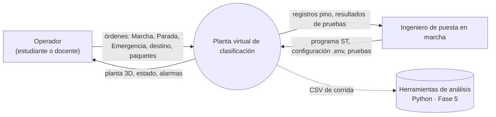
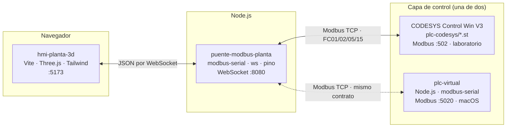
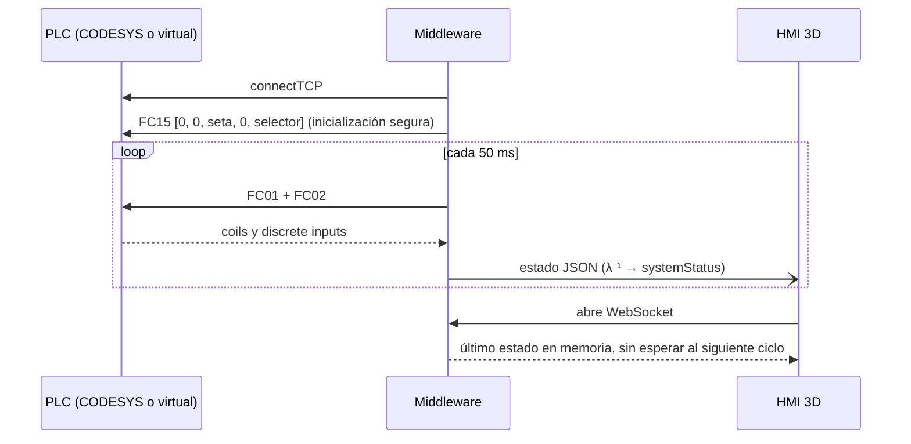
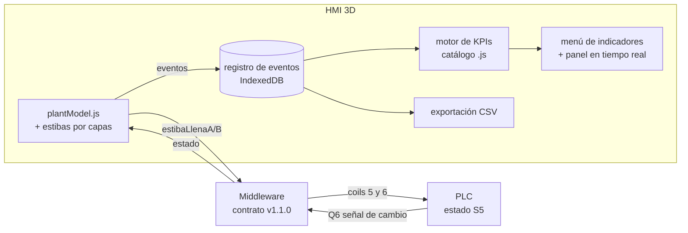

# 05 · Arquitectura de software implementada

*Proyecto:* Planta Virtual de Clasificación Gobernada por PLC · *Versión:* 1.0.0 · *Fecha:* 2026-10-23 · *Estado:* Fases 1–4 implementadas; de la Fase 5, estibas y estado S5 implementados, indicadores e informe CSV en diseño (§11)

---

## 1. Propósito y alcance

`01_arquitectura_y_flujos.md` fija la arquitectura de referencia de la Fase 1: tres capas, un modelo de control y un contrato de datos. Este documento describe lo que efectivamente se construyó sobre ella en las Fases 2 a 4: los módulos de cada capa, sus interfaces, el despliegue en macOS y en el laboratorio, las decisiones que se tomaron por el camino y la forma de extender el sistema. Se organiza en vistas: contexto, contenedores, componentes, interfaces, dinámica y despliegue.

## 2. Vista de contexto



## 3. Vista de contenedores

Cada capa es un proceso independiente que se comunica con las demás solo a través de interfaces de red.



| Contenedor | Tecnología | Dependencias fijadas | Puerto |
|---|---|---|---|
| `plc-codesys/` | IEC 61131-3 · Texto Estructurado | CODESYS V3.5 SP19+ y Control Win V3 x64 | 502 (Modbus) |
| `plc-virtual/` | Node.js ≥ 20.19, ESM | `modbus-serial` 8.0.25 | 5020 (Modbus) |
| `puente-modbus-planta/` | Node.js ≥ 20.19, ESM | `modbus-serial` 8.0.25, `ws` 8.22.0, `pino` 10.4.0, `dotenv` 18.0.9; desarrollo: `pino-pretty` 13.2.0 | 8080 (WebSocket) |
| `hmi-planta-3d/` | Navegador con WebGL 2 | `three` 0.186.1; desarrollo: `vite` 8.3.5, `tailwindcss` y `@tailwindcss/vite` 4.3.3 | 5173 (Vite) |

Las versiones se fijan de forma exacta (`--save-exact`) para que el laboratorio y el entorno de desarrollo ejecuten el mismo código.

## 4. Vista de componentes

### 4.1 Capa de control: `plc-codesys/` y `plc-virtual/`

| Módulo | Responsabilidad |
|---|---|
| `plc-codesys/variables_globales.st` | `E_EstadoClasificador`, `GVL_IO` (direcciones `AT %IX/%QX`) y `GVL_Param` (tiempos) |
| `plc-codesys/logica_clasificador_fsm.st` | `FB_Heartbeat`, `FB_ClasificadorFSM` (máquina de Moore) y `PLC_PRG` (cableado) |
| `plc-codesys/config_modbus_slave.json` | Parámetros de referencia del esclavo Modbus |
| `plc-virtual/src/iec61131.js` | Bloques estándar `TON` y `R_TRIG` |
| `plc-virtual/src/clasificador.js` | Traducción 1:1 de los `.st`: mismos nombres, mismo orden de evaluación (a)…(e), transiciones T1–T10 |
| `plc-virtual/src/plcVirtual.js` | Tarea de 10 ms programada sobre la marca ideal k·T_scan (imagen de entradas → `PLC_PRG` → imagen de salidas) y esclavo Modbus TCP. Emite `entrada`, `estado` y `falla`; `pausar()` y `reanudar()` emulan STOP/RUN |
| `plc-virtual/src/index.js` | Arranque; registra órdenes y transiciones; acepta `stop`/`run` por teclado |
| `plc-virtual/test/cp.test.js` | Protocolo CP-01…CP-19 como maestro Modbus, válido contra cualquier esclavo del contrato |

### 4.2 Middleware: `puente-modbus-planta/`

| Módulo | Responsabilidad | Interfaz principal |
|---|---|---|
| `src/config/env.js` | Lee y valida `.env`; un valor inválido detiene el arranque | `cargarEntorno()`, `cargarConfig(env)` |
| `src/models/dataContract.js` | Bits → JSON, $\lambda^{-1}$, degradación segura, lista blanca, `ack` | `construirEstado()`, `validarComando()`, `crearAck()`, `COMANDOS` |
| `src/services/modbusClient.js` | Conexión única, cola FIFO, lectura reprogramada, pulsos, reconexión exponencial, FC15 al reconectar | clase `ClienteModbus`; eventos `conectado`, `desconectado`, `reintento`, `lectura` |
| `src/services/websocketServer.js` | Difusión del estado; recepción de comandos (máx. 4 KB); envío del último estado al conectar | clase `ServidorWebSocket`; evento `comando` |
| `src/index.js` | Orquestación, vigilancia del heartbeat, registro con pino | `iniciarPuente(config, log)` |
| `scripts/consola.js` | Operador en texto (sin HMI 3D) | `npm run consola` |
| `scripts/demo.js` | Demostración narrada de PLC y middleware en procesos separados | `npm run demo` |

### 4.3 HMI 3D: `hmi-planta-3d/`

| Módulo | Responsabilidad |
|---|---|
| `src/core/plantModel.js` | Geometría (`GEOMETRIA`), recorridos (`TRAMOS`), cinemática de paquetes, sensor por AABB, decisión de ruta por la paleta, contadores y estibas (posiciones por capas, colocación en arco, desborde y cambio con entrada por el costado libre). Sin renderizado: se prueba en Node |
| `src/core/sceneManager.js` | Renderizador WebGL, cámara orbital, luces, suelo, niebla y capa de etiquetas; reparte $\Delta t$ (máximo 1 s; `main.js` lo simula en subpasos de 50 ms) |
| `src/core/wsClient.js` | WebSocket al middleware con reconexión (0,5 → 5 s); eventos `estado`, `ack`, `conexion` |
| `src/components3d/conveyorBelt.js` | Cinta con banda animada, bastidor, patas y motor con piloto |
| `src/components3d/diverterMechanism.js` | Paleta de 45° con pivote calculado y recorrido de 0,15 s |
| `src/components3d/sensorsAndBeacons.js` | Sensor fotoeléctrico (haz y piloto de lectura de retorno) y baliza de dos módulos: roja (Q4) y ámbar (Q6) |
| `src/components3d/packageSpawner.js` | Cajas sincronizadas con el modelo (en la cinta, en vuelo o apiladas) y estibas que se desplazan con su carga durante el cambio |
| `src/ui/operatorPanel.js` | Mando, estado, conexiones, contadores, estibas (carga, capacidad y cambio), eventos y atajos de teclado |
| `src/ui/hudLabels.js` | Etiquetas CSS2D con dirección de E/S y valor en vivo |
| `src/main.js` | Une las piezas; en cada fotograma traduce `outputs` en movimiento, en subpasos de 50 ms, y la ocupación del haz y de las estibas en comandos |

## 5. Interfaces

### 5.1 Modbus TCP

El mapa de memoria, las funciones y la semántica de cada bit se definen en `02_mapeo_memoria_modbus.md` (contrato v1.1.0). El mapa es inmutable: las ampliaciones solo añaden direcciones, nunca reasignan las existentes.

### 5.2 Mensajes WebSocket

| Mensaje | Sentido | Contenido |
|---|---|---|
| Estado | middleware → HMI, cada ≈ 50 ms y al conectar | `timestamp`, `plcConnected`, `heartbeat`, `inputs` (5), `outputs` (5), `systemStatus` (`02` §4.1) |
| Comando | HMI → middleware | `{ type: "command", target, action: "pulse" \| "set", value? }` |
| Respuesta | middleware → HMI | `{ type: "ack", target, ok, error? }` |

Códigos de error del `ack`:

| Código | Causa |
|---|---|
| `JSON_INVALIDO` | El mensaje no es JSON |
| `TIPO_NO_SOPORTADO` | `type` distinto de `command` |
| `TARGET_NO_PERMITIDO` | El destino no está en la lista blanca |
| `ACCION_NO_PERMITIDA` | Acción incompatible con el destino (p. ej., `set` sobre `marcha`) |
| `VALOR_INVALIDO` | `set` sin un valor booleano |
| `PLC_DESCONECTADO` | No hay conexión con el PLC |
| `ERROR_MODBUS` | La transacción Modbus falló |

Un `ack` correcto confirma que el coil se escribió en el esclavo; el PLC lo lee en su siguiente ciclo, hasta 10 ms después.

### 5.3 Configuración

| Variable | Contenedor | Valor por defecto | Descripción |
|---|---|---|---|
| `MODBUS_HOST`, `MODBUS_PORT`, `MODBUS_UNIT_ID` | middleware | `127.0.0.1`, `5020` (macOS) o `502` (laboratorio), `1` | Esclavo Modbus |
| `MODBUS_TIMEOUT_MS` | middleware | `2000` | Plazo de cada transacción |
| `POLL_INTERVAL_MS` | middleware | `50` | Periodo de lectura $T_p$ |
| `HEARTBEAT_STALE_MS` | middleware | `1500` | Umbral de heartbeat congelado |
| `PULSE_WIDTH_MS` | middleware | `150` | Ancho de los pulsos; debe superar `POLL_INTERVAL_MS` |
| `RECONNECT_BASE_MS`, `RECONNECT_MAX_MS` | middleware | `500`, `5000` | Retroceso exponencial |
| `WS_HOST`, `WS_PORT` | middleware | `127.0.0.1`, `8080` | `0.0.0.0` abre el WebSocket a la red |
| `LOG_LEVEL` | middleware | `info` | `trace` … `error`, o `silent` |
| `PLC_HOST`, `PLC_PORT`, `PLC_UNIT_ID` | PLC virtual y sus pruebas | `127.0.0.1`, `5020`, `1` | Enlace del esclavo; en las pruebas, esclavo externo |
| `?ws=ws://host:puerto` | HMI (URL) | `ws://<equipo que sirve la HMI>:8080` | Otro middleware |
| `?auto=1` | HMI (URL) | desactivado | Alimentación automática al abrir |

## 6. Vista dinámica

### 6.1 Arranque y conexión



### 6.2 Orden del operador y sensor emulado

```mermaid
sequenceDiagram
  participant OP as Operador
  participant HMI as HMI 3D
  participant MW as Middleware
  participant PLC as PLC
  OP->>HMI: Marcha (clic o tecla M)
  HMI->>MW: command marcha / pulse
  MW->>PLC: FC05 coil 0 = 1 … 150 ms … FC05 coil 0 = 0
  MW-->>HMI: ack ok
  PLC->>PLC: T2 · S0 → S1 (flanco de Marcha)
  Note over HMI: el paquete corta el haz (AABB)
  HMI->>MW: command sensorEntrada / set true
  MW->>PLC: FC05 coil 3 = 1
  PLC->>PLC: T4 o T5 según el selector (S2 o S3)
  MW-)HMI: estado CLASIFICANDO_RUTA_x
  Note over HMI: la paleta gira; el paquete toma su ruta y cae
```

### 6.3 Caída del PLC y recuperación

```mermaid
sequenceDiagram
  participant PLC as PLC
  participant MW as Middleware
  participant HMI as HMI 3D
  PLC--xMW: la transacción falla (Port Not Open o timeout)
  MW-)HMI: SIN_CONEXION_PLC (salidas en falso)
  Note over HMI: banda de aviso; cinemática congelada
  loop 0,5 · 1 · 2 · 4 · 5 s
    MW->>PLC: connectTCP
  end
  MW->>PLC: FC15 conservando seta y selector
  MW-)HMI: estado vivo
  HMI->>MW: reenvía sensorEntrada si el haz está ocupado
```

## 7. Vista de despliegue

| Aspecto | macOS (desarrollo) | Windows (laboratorio SILOGE) |
|---|---|---|
| Capa de control | `plc-virtual/` en `127.0.0.1:5020` | CODESYS Control Win V3 en `127.0.0.1:502` |
| Arranque | `./iniciar.sh` levanta las tres capas y abre el navegador | CODESYS más dos ventanas: `npm run dev` en el middleware y en la HMI |
| `.env` del middleware | `.env.example` (puerto 5020) | `windows/puente-modbus-planta.env` (puerto 502) |
| Acceso desde otros equipos | No previsto | `WS_HOST=0.0.0.0`, `npm run dev -- --host`, reglas de Firewall TCP 5173 y 8080 |
| `node_modules/` | Se instala en el Mac | Se instala en cada equipo; contiene binarios nativos por sistema |

El puerto 5020 en macOS se explica en `03_manual_puesta_en_marcha.md` §2: el sistema solo permite puertos menores que 1024 sin privilegios cuando se escucha en todas las interfaces, y el contrato exige *loopback*.

## 8. Decisiones de arquitectura

| # | Decisión | Alternativa descartada | Motivo |
|---|---|---|---|
| D1 | La HMI nunca decide transiciones; solo emula la planta y transmite órdenes | Lógica de proceso en el navegador | Separación entre control (C1) y supervisión (C3); el programa validado es el del PLC |
| D2 | PLC virtual como traducción 1:1 de los `.st`, verificado con el mismo protocolo que CODESYS | Intérprete de ST o PLC alternativo (OpenPLC) | El ST usa construcciones propias de CODESYS; OpenPLC invierte la convención de coils |
| D3 | Puerto 5020 en `127.0.0.1` en macOS | Puerto 502 en `0.0.0.0` | Mantener el esclavo fuera de la red |
| D4 | Lectura de retorno (FC01) de las órdenes | Publicar el último valor pedido | El estado mostrado es el que el PLC lee, no el que se pidió |
| D5 | Cola FIFO y lectura reprogramada con `setTimeout` | `setInterval` y transacciones concurrentes | Sin solapamiento de tramas ni acumulación de peticiones |
| D6 | FC15 al reconectar, conservando seta y selector | Reanudar sin inicializar | Ningún arranque inesperado; la emergencia sobrevive a la desconexión |
| D7 | Degradación segura: salidas en falso y escena congelada | Mostrar el último estado conocido | Sin información confiable no se sugiere movimiento |
| D8 | Modelo cinemático puro y probado en Node | Lógica mezclada con el renderizado | Pruebas rápidas y deterministas de la geometría frente a $T_{clas}$ |
| D9 | Una sola HMI activa | Varias HMI simultáneas | Cada HMI emula su propio sensor; dos enviarían señales contradictorias |
| D10 | Cierre de la conexión Modbus con plazo de 500 ms | Esperar al callback de `close()` | `modbus-serial` no llama al callback si el otro extremo ya cerró; sin el plazo, detener el middleware tras una caída del PLC lo dejaba colgado |

## 9. Calidad y pruebas

| Conjunto | Pruebas | Qué verifica | Duración |
|---|:-:|---|---|
| `plc-virtual` · `npm test` | 24 | Contrato FC01 y protocolo CP-01…CP-19 (CP-09 con 4 orígenes) | ≈ 25 s |
| `puente-modbus-planta` · `npm test` | 16 | 8 unitarias de configuración y contrato; 8 de integración: cadencia, estructura del JSON, ancho de pulso, readback, lista blanca, estiba llena con paso a S5, heartbeat congelado, caída y reconexión con FC15 | ≈ 4 s |
| `hmi-planta-3d` · `npm test` | 15 | Geometría frente a $T_{clas}$, movimiento según salidas, congelación, sensor AABB, ruta B, mal clasificado, separación, generación; estibas: posiciones, capas, capacidad, señal, cambio sin solape entre estibas, desborde | < 1 s |
| Extremo a extremo (2026-10-23) | — | Chrome sin interfaz con clics reales: rutas A y B, alimentación automática, emergencia, rearme, caída del PLC y ciclo completo de estiba; 0 mal clasificados, 0 desbordes y sin errores de JavaScript | ≈ 25 s |

Limitaciones conocidas: la pestaña de la HMI debe permanecer visible; por debajo de 1 fotograma por segundo la planta se desincroniza del PLC; solo una HMI a la vez; la validación contra CODESYS está pendiente (`windows/REGISTRO_DE_CAMBIOS.md`).

## 10. Guía de extensión

| Cambio | Pasos |
|---|---|
| Lógica del PLC | (1) Modificar los `.st`. (2) Replicar en `plc-virtual/src/clasificador.js` con los mismos nombres. (3) Ampliar `cp.test.js` y pasar `npm test`. (4) Registrar el cambio en `windows/REGISTRO_DE_CAMBIOS.md` para recargarlo en CODESYS |
| Nuevo comando u orden | Ampliar el contrato en `02` sin reasignar direcciones; añadir el destino a `COMANDOS` en `dataContract.js`, el coil en el PLC, la prueba de integración y el control en el panel |
| Geometría de la planta | Editar `GEOMETRIA` en `plantModel.js`. La prueba de despeje falla si el nuevo trazado no cabe en $T_{clas}$; en ese caso debe revisarse el parámetro del PLC |
| Aspecto visual | Paleta en `industrial-theme.css` (tokens `planta-*`) y materiales en `components3d/` |

Convenciones: módulos ESM, identificadores y comentarios en español, nombres del PLC conservados en el PLC virtual (`eEstado`, `TON_Clasif`, T1–T10) y dependencias fijadas sin rangos.

## 11. Arquitectura de la Fase 5

La Fase 5 añade indicadores de desempeño, estibas de salida y el informe de corrida. Las decisiones aprobadas son: *A*, el PLC detiene la línea cuando una estiba se llena; CSV orientado a Python; capacidad de estiba ajustable con 12 unidades por defecto. La especificación completa está en `08_especificacion_fase5.md`; el resumen arquitectónico es:



| Componente nuevo o modificado | Capa | Cambio |
|---|---|---|
| `FB_ClasificadorFSM` y `clasificador.js` | C1 | Estado S5 «Esperando cambio de estiba», transiciones T9 y T10, guarda adicional en T2, salida Q6 |
| Esclavo Modbus | C1 | Coils 5 y 6 (`%IX0.5`, `%IX0.6`) y discrete input 6 (`%QX0.6`): contrato v1.1.0 |
| `dataContract.js` | C2 | Nuevos campos, destinos `estibaLlenaA` y `estibaLlenaB`, $\lambda^{-1}$ sobre seis bits y estado `ESPERANDO_CAMBIO_ESTIBA` |
| `src/kpi/catalogo.js`, `registro.js`, `motor.js` | C3 | Definición de indicadores, registro de eventos en IndexedDB y cálculo en tiempo real |
| `src/ui/menuIndicadores.js` y panel | C3 | Barra superior, menú desplegable y tarjetas de KPIs |
| `plantModel.js` y `packageSpawner.js` | C3 | Estibas con patrón por capas, capacidad ajustable y cambio de estiba |

*Estado al 2026-10-23:* implementadas las filas de C1 y C2 y la de `plantModel.js` y `packageSpawner.js` (estibas, S5, contrato v1.1.0); pendientes `src/kpi/`, el menú de indicadores y la exportación CSV.
